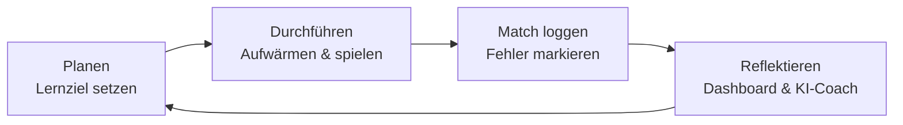

# Marvel Rivals Coach :material-controller:

Besser werden in einem Spiel funktioniert nach denselben Prinzipien wie jedes andere Lernen:
**Ziele setzen, gezielt üben, reflektieren.** Der *Rivals Coach* ist eine kleine Web-App, die dich
genau dabei unterstützt – und zeigt, wie KI-Tools als persönlicher Coach eingesetzt werden können.

[Rivals Coach öffnen :material-open-in-new:](app/){ .md-button .md-button--primary target="_blank" }

## So ist die App aufgebaut

Die App hat **sieben Bereiche**, damit du den Überblick behältst. Am Handy stehen sie als Leiste unten, am Computer oben, darunter die Unterseiten des jeweiligen Bereichs. Pro Bereich stehen nur die zwei bis vier wichtigsten Unterseiten direkt da, die übrigen unter **«Mehr»** (zum Beispiel Quiz, Schwächen, Zuschauen und Lexikon im Bereich Lernen).

| Bereich | Unterseiten |
|---|---|
| **Heute** | Ganz oben **«Jetzt dran»**: genau ein Schritt mit einem Knopf und der Phase, in der du gerade bist. Direkt darunter **«Dein nächstes Match»**: an einem Plantag genau **eine Sache**, auf die du im nächsten Match achtest, dazu «Match 3 heute · Block 1», das messbare Ziel oder «Geschafft, wenn …» und eine Zeile, was danach kommt (siehe «Ein Match, eine Sache»). Grundregeln, Wochenziel, Missionen, zusätzlich gewählte Punkte und eine **Konter-Regel zum Lernen** stehen eingeklappt unter **«Läuft nebenbei»**: Sie laufen im Hintergrund mit, aktiv denkst du nur an die eine Sache. Darunter **«Heute zu tun: dein Tagesablauf»**, immer in derselben Reihenfolge und passend zu den Abschnitten des Trainingstags: **1 · Vorbereiten** (Lektion, Trainingstag mit Vorbereitung, einmal pro Woche das Wochenziel; nur ohne Plantag: eine Sache fürs Match wählen), **2 · Spielen** (Block 1 bis 3, nach jedem Match die Notiz), **3 · Auswerten** (Review, Trainingstag abschliessen), **Wenn du noch Lust hast** (Matches von heute und gestern ohne Notiz, Aufgabe des Wochenziels, weitere Matches fürs Review, Challenge der Woche; zählt nicht mit). Ältere Matches ohne Notiz stehen nur noch unter «Spielen › Matches», nicht mehr als Aufgabe. Jeder Schritt sagt, wo du ihn machst, vieles hakt sich von selbst ab. Eingeklappt unter «Mehr für heute»: Challenge der Woche, Rang-Weg, App-Übungen und Wegweiser. |
| **Woche** | Neben «Heute»: **«Diese Woche auf einen Blick»** sammelt alle laufenden Aufgaben und sagt zu jeder, **wo du sie abhakst** oder ob sie sich selbst abhakt: heute (Trainingstag, Review, Lektion, fällige Fragen), im Match (dein Fokus), diese Woche (Aufgaben des Wochenziels, Missionen, Bootcamp-Aufgaben) und die Challenge der Woche. Darunter wie bisher das Wochenziel (Planen, Durchführen, Reflektieren). |
| **Lernen** | Trainingsplan, Lektionen, Quiz, Helden-Bootcamp, Schwächen, Zuschauen, Lexikon (mit den Spielregeln) |
| **Spielen** | Matches (mit den Bereichen «Offen», «Eintragen», «Verlauf»), Dashboard, Squad, Auswertung, Verlauf, Rang-Weg |
| **Review** | Eigener Reiter für Replays, auch wenn du einfach Lust und Zeit hast. Reihenfolge: **1 · Matches mit Notiz**, die noch nicht ausgewertet sind (am schnellsten, die Notiz ist der Ausgangspunkt), **2 · Matches, die zu deinen Schwächen passen** (Themen, die gerade oft danebenliegen, offene Missionen, verfehlter Fokus), **3 · alle anderen**; innerhalb der Gruppe zuerst das Replay, das am frühesten verschwindet. Die ersten davon sind deine Tagesmenge (Pflicht im Trainingsplan), darunter stehen unter «Wenn du Lust und Zeit hast» alle weiteren, nach denselben Gruppen. Jedes ausgewertete Match zählt mit. Als offen zählen nur Matches, deren Replay im Spiel noch da ist (Standard: die letzten 40 und deine Einstellung zu den Tagen); ältere stehen weiter unter «Spielen › Matches», warten aber nicht mehr als Aufgabe. |
| **Helden** | Helden-Guide, Team & Counter, Team-Ups, Meta & Patch |
| **Coach** | Daten & Sync, Training, KI-Coach |

Mit der **Suche** (Lupe oben oder Taste `/`, `Strg+K`) findest du Seiten, Helden (auch unter Spitznamen), Lektionen, Begriffe, Team-Ups und Patch-Einträge. Lange Seiten wie der Trainingsplan haben **einklappbare Karten**: Offen ist, was du jetzt brauchst (zum Beispiel die aktuelle Phase), der Rest bleibt zu. Die App merkt sich, was du geöffnet hast.

- **Ein Trainingstag Schritt für Schritt:** Ein Tag hat Abschnitte: Vorbereitung (Worauf es heute ankommt, Lektion, Wochenziel, Nachlesen, Start), Block 1 bis 4, gegebenenfalls Nachholen, Abschluss (Aufschreiben, Matches des Tages, Wissens-Check, Rückblick, Tag abschliessen). Offen ist nur der Abschnitt, der jetzt dran ist; sobald du ihn abhakst, klappt er zu und der nächste auf. Unter dem Titel springen runde Knöpfe zu jedem Abschnitt, «Alle Schritte zeigen» klappt alle auf (das merkt sich das Gerät). Das Schwächen-Training steht in Block 3, Matchlänge und Übungszeit pro Block unter «Ablauf und Matchlänge» in der Vorbereitung.
- **Plan-Übersicht:** oben der nächste Trainingstag, darunter «Alle Trainingstage» (die Phasen), dann «Einstellungen» (Pool und Hauptrolle, Lernpfad) und «Nachschlagen» (Eternity, So bleibt alles hängen, Alle Rollen, Themen-Tracker, Drills, Regeln, Wochenpaket), alles zugeklappt.
- **Gezielt üben (Block 3 und Thema des Tages):** Wählst du in Block 3 ein Thema als Mini-Ziel (oder den Vorschlag des Plans), zeigt die App drei Dinge: eine **konkrete Aufgabe** als Wenn-dann-Satz, ein **messbares Ziel** für die Matches von Block 3 (zum Beispiel «in mindestens 4 der 6 Matches höchstens 1 Tod durch Position oder Vom Team getrennt», «mindestens die Hälfte der Ults mit Wirkung», «Schaden pro 10 Minuten 10 % über deinem Schnitt, ohne mehr Tode», «Treffgenauigkeit 2 Punkte über deinem Schnitt») mit Stand, und **«Damit übst du es am besten»**: bis zu drei Helden, zuerst aus deinem Pool, mit Begründung. Die Begründung ist entweder ein Zitat aus dem Heldenprofil (zum Beispiel eine Ult, die das Team heilt oder schützt, für das Thema «Gegnerische Ult und Ult-Economy»: damit übst du, die Ult gezielt zur Verteidigung zu halten) oder eine Faustregel aus den Spielstil-Tags der App (zum Beispiel «wenig Fluchtmöglichkeiten» für Positionierung), was dann so dasteht. Die Ziele richten sich nach deinem eigenen Schnitt der letzten 20 Matches, nicht nach erfundenen Zahlen. Matches ohne Messwert (etwa ohne eingetragene Todesursachen) zählen nicht mit; die App sagt das dazu. «Heute zählt nur das» nennt beim neuen Thema ebenfalls Übungs-Helden.
- **Schnellnotiz nach dem Match:** Unten rechts steht auf jeder Seite der Knopf **«Notiz»**. Nach jedem Match tippst du in der Ladezeit kurz ein: Ults (eingesetzt und mit Wirkung), Todesursachen (die fünf Gruppen des Plans: Position, Fluchtweg/Cooldown, Gegnerische Ult, Zu gierig, Vom Team getrennt), Mini-Ziel geschafft, Solo oder Stack, Voice, den Zusatz des Tages aus dem Plan und einen Satz. Held, Ergebnis und Tode holt der Abgleich selbst. Die App ordnet die Notiz über die Uhrzeit dem Match zu (dem letzten Match, das vor der Notiz begann). Sicher ist das erst, wenn der Abgleich auch ein späteres Match kennt oder der Tag vorbei ist; bis dahin wartet die Notiz unter «Matches → Offen», wo du sie auch selbst zuordnen kannst. Im Trainingstag zeigt «Aufschreiben» statt der Standardzeile den Stand der Notizen; der Schritt hakt sich ab, sobald mindestens 80 % der Matches von heute eine Notiz haben und die Aufgaben fürs Tagesende ausgefüllt sind. Die Zuordnung über die Uhrzeit ist eine Schätzung: Liegt sie daneben, ordne die Notiz unter «Offen» selbst zu.
- **Matches:** drei Reiter. «Offen» zeigt die von Rivals Data geholten Matches, zu denen noch Fehler und Stärken fehlen (die Zahl steht am Reiter); «Eintragen» ist das Formular, auch zum Bearbeiten; «Verlauf» ist die Liste aller Matches mit der Match-Analyse. Wartet etwas, öffnet die Seite bei «Offen». Nach dem Bearbeiten kommst du dorthin zurück, wo du warst.

## Aussehen

Die App ist im **Gaming-Look** gestaltet: dunkle Spiel-Oberfläche, Violett für Aktionen, Gold für Belohnungen und die Rollenfarben (Tank blau, DPS orange, Support grün) überall, wo es um Helden geht. Knöpfe und Banner haben schräge Ecken wie in Spiel-Menüs, Helden erscheinen als Sechsecke mit Rollenfarbe. Ohne eigene Wahl ist die App dunkel; mit «Hell / Dunkel» (Seitenleiste oder Mond-Symbol am Handy) wechselst du auf das helle Design. Es gibt zwei **Stile**: «Neon» (der Gaming-Look oben) und «Rosé» (Beere, Pink und Lavendel, Roségold für Belohnungen, runde Formen, eine runde Schrift, Formleiste als Perlen, Konfetti als Sternchen). Umschalten mit «Stil» in der Seitenleiste oder dem Funkel-Symbol am Handy; die Wahl merkt sich der Browser. Die private Version startet mit «Rosé» (`DEFAULT_LOOK` in `private.json`), alle anderen mit «Neon».

**Grafiken:**
- **Heute → «Deine Form»:** die letzten zwölf Matches als Leiste (S = Sieg, N = Niederlage, unten die Rollenfarbe), deine aktuelle Serie, vier Kennzahlen mit Verlaufslinie (Winrate, Tode pro 10 Minuten, die Hauptkennzahl deiner Hauptrolle pro 10 Minuten, KDA; Pfeile vergleichen mit den 20 Matches davor) und die Rollenverteilung.
- **Match-Verlauf:** dieselbe Leiste über den letzten 20 Matches.
- **Dashboard:** alle deine Zahlen auf einer Seite (siehe unten bei «Dashboard»).
- **Helden-Guide:** Heldenkarten mit Rollenfarbe, Rollen-Emblem, Matches als Ring und Winrate, KDA und Tode pro 10 Minuten (Werte pro Held nur aus dem Anteil des Haupthelden).
- **Rang-Weg:** Die Stufenleiter von Bronze bis Eternity mit drei Häkchen pro Stufe; «Du bist hier» blau umrandet, «Nächstes Ziel» gold. Beim Endziel Eternity unter jeder Kennzahl ein Balken: dein Wert, die mittlere Hälfte der Eternity+-Spieler, die Mitte von Eternity+ (gold) und von Celestial (grau).
- **Belohnungen:** Abzeichen als Sechseck-Medaillen, eine flackernde Flamme bei deiner Trainingsserie und ein kurzer Konfetti-Regen, wenn du einen Trainingstag, das Review, eine Lektion, eine Mission oder ein Abzeichen schaffst. Der Effekt lässt sich bei den Abzeichen ausschalten und läuft nicht, wenn dein Gerät «weniger Bewegung» eingestellt hat.

## Dashboard

Unter **Spielen → Dashboard** stehen alle deine Zahlen auf einer Seite. Alles kommt aus deinen eigenen Matches, es gibt kein neues Spielwissen.

- **Filterleiste oben:** Zeitraum (Heute, 7, 30, 90 Tage, Alles), Rolle, Held und Modus. Die Filter gelten für alle Karten darunter, so passen die Zahlen immer zusammen. Der Browser merkt sich deine Wahl.
- **Kopf:** die Winrate als grosse Zahl, Siege, Niederlagen und Ø Matchdauer, der Vergleich mit dem gleich langen Zeitraum davor (bei «Alles» ohne Vergleich), die Formleiste und deine Serie. Daneben vier Kennzahlen mit Verlaufslinie und Pfeil: KDA, Tode pro 10 Minuten, die Hauptkennzahl der Rolle pro 10 Minuten (Heilung, Schaden oder Geblockt; bei gemischten Rollen nur aus den Matches dieser Rolle) und Ult-Wirkung.
- **Leistungsverlauf:** Match für Match, bis zu 60 Matches. Die Linie ist der Schnitt der letzten 5 Matches (ab 40 Matches der letzten 10), die feine Linie dein Schnitt im Ausschnitt, unten Sieg und Niederlage pro Match. Umschaltbar auf KDA, Tode, Heilung, Schaden und Geblockt (dann auch jedes Match als Punkt). Mit dem Finger oder der Maus über das Diagramm fahren zeigt Datum, Held, Ergebnis, K/D/A, Wert und Karte. Mit der Tastatur: Diagramm anwählen, dann Pfeiltasten.
- **Rollen:** Anteil als Balken und Winrate pro Rolle.
- **Deine Helden:** Matches, Winrate (Balken ab der Mitte bei 50 %), KDA und Tode pro 10 Minuten. Einen Helden antippen filtert das ganze Dashboard auf ihn, nochmals antippen löst den Filter. Mit Heldenfilter zählen bei gewechselten Matches nur die Werte des Haupthelden (wie im Helden-Guide).
- **Spielkalender:** die letzten 12 Wochen, je dunkler, desto mehr Matches an dem Tag. Dazu Spieltage, Ø Matches pro Spieltag, längste und aktuelle Serie. Er zeigt immer 12 Wochen; Rolle, Held und Modus gelten.
- **Was in Siegen anders ist:** pro Kennzahl dein Wert in Siegen und in Niederlagen, der grösste Unterschied zuerst. Gezählt werden nur Matches, in denen der Wert vorkommt (Heilung 0 bei DPS zählt nicht), und nur ab 3 Siegen und 3 Niederlagen mit Wert. Bei gemischten Helden empfiehlt die Karte, einen Helden zu wählen: Gleiches mit Gleichem vergleichen.
- **Wann du am besten spielst:** Winrate für das 1., 2., 3. … Match des Tages und nach Tageszeit. Blasse Säulen beruhen auf weniger als 3 Matches.
- **Deine Karten** und **Gegen diese Helden:** Winrate gegenüber deinem eigenen Schnitt im Ausschnitt (rechts besser, links schwächer). Karten ab 2 Matches, Gegner-Helden ab 3 Matches.
- **Woran du stirbst, Häufigste Fehler, Coach-Hinweise:** wie bisher, die ersten beiden aus den letzten 20 Matches im Ausschnitt.
- **Tabelle:** Jede Diagramm-Karte hat oben rechts «Tabelle». Dort stehen dieselben Zahlen zum Nachlesen, ohne Diagramm.

Die Diagramme folgen festen Regeln: dünne Linien und Balken, Grün und Rot nur für Sieg und Niederlage, Rollenfarben nur für Rollen, keine zwei Skalen in einem Diagramm. Die Rollenfarben der Diagramme sind im dunklen Modus etwas dunkler als sonst in der App, damit sie auch bei Farbschwäche unterscheidbar bleiben (geprüft mit einem Farbsehschwäche-Test).

## Match-Analyse und Squad

**Was geht und was nicht:** Replays lassen sich nur im Spiel anschauen. Einen Weg, sie herunterzuladen oder auszulesen, gibt es nach unserer Recherche nicht (Stand Oktober 2026). Laufwege, Positionen, Fights und Ult-Zeitpunkte kann die App deshalb nicht auswerten. Über die Match-ID liefert Rivals Data aber die Tabelle aller 12 Spieler: Held (mit Spielzeit), K/D/A, Final Hits, Solo-Kills, Schaden, Heilung, Geblockt, Treffergenauigkeit, MVP/SVP und ob es ein Bot war. Seit diesem Update holt der Abgleich diese Tabelle für jedes Match mit (Felder `team`, `foes`, `fh`, `solo`, `acc`; Matches von früher werden beim nächsten Abgleich einmal neu geholt, soweit sie noch in der Match-History von Rivals Data stehen, das sind etwa die letzten 40 bis 50).

**Mitspieler bleiben anonym:** Von deinen Mitspielern speichert der Abgleich nur ein Kürzel des Namens (FNV-1a, acht Zeichen), nie den Namen selbst. Die App bildet dasselbe Kürzel aus den Namen deiner Teammates und erkennt sie so. Fremde Spieler erscheinen nur mit ihrem Helden. Gegner bekommen gar kein Kürzel.

**Match-Analyse:** Im Match-Verlauf hat jedes Match mit diesen Daten den Knopf «Analyse», im Review den Knopf «Match-Tabelle». Er öffnet beide Teams mit allen Werten (du und deine Teammates hervorgehoben, der höchste Wert im ganzen Match fett) und automatische Hinweise: dein Anteil an der Heilung, am Schaden oder am geblockten Schaden deines Teams (mit Platz im Team und im ganzen Match), deine Final Hits im Team, wer in deinem Team am häufigsten gestorben ist, der gefährlichste Gegner (meiste Final Hits), Tode und Schaden beider Teams, deine Treffergenauigkeit im Vergleich zu deinem Schnitt mit dem Helden, Bots im Match und welche Teammates dabei waren. Im Dashboard gibt es dazu im Leistungsverlauf und bei «Was in Siegen anders ist» die Kennzahlen Final Hits pro 10 Minuten und Treffergenauigkeit.

**Squad (Spielen → Squad):** Oben trägst du deine Teammates ein, genau wie im Spiel geschrieben (Gross- und Kleinschreibung egal). Neben jedem Namen steht, in wie vielen Matches er gefunden wurde; «noch nicht gefunden» heisst: in den Matches mit Team-Daten nicht dabei oder anders geschrieben. Darunter, mit Filtern für Zeitraum, Teammate und Modus:
- **Kopf:** deine Winrate mit Teammates, verglichen mit deinen Matches ohne, wer am häufigsten dabei ist und die Tode pro 10 Minuten pro Person bei euch und bei den Gegnern.
- **Das Wichtigste:** bis zu fünf Hinweise (bester Teammate, stärkstes Helden-Paar, schwierigster Gegner, grösster Unterschied zwischen euren Siegen und Niederlagen, häufigste Team-Notiz).
- **Mit wem du gewinnst** und **Eure Gruppen** (wer genau zusammen war), jeweils gegenüber deinem Schnitt.
- **Helden-Paare** (dein Held mit dem Helden eines Teammates) und **Eure Aufstellungen** (Rollen im ganzen Team, zum Beispiel 2 Tank · 2 DPS · 2 Support).
- **Gegner, die euch Probleme machen:** Gegner-Helden unter eurem Schnitt (ab 3 Matches). Darunter steht, welche eurer Helden in diesen Matches trotzdem gewonnen haben; gibt es keine, nennt die Karte die Counter-Faustregel und schreibt dazu, dass sie nicht aus euren Matches stammt.
- **Was in euren Siegen anders ist:** Team-Werte pro 10 Minuten in Siegen und Niederlagen (Tode, Final Hits, Schaden, Heilung, Tode pro Rolle).
- **Eure Rollen gegen die Gegner:** Tode und Final Hits pro 10 Minuten eurer Tanks, DPS und Supports gegen die gegnerischen.
- **Deine Teammates mit dir:** pro Person die Helden, Ø K/D/A, Tode, Final Hits und die Hauptkennzahl der Rolle pro 10 Minuten. Die Zahlen sind zum Besprechen gedacht, nicht als Schuldfrage: Rolle und Held prägen sie stark.
- **Team-Ups in eurem Team:** Team-Ups aus der Team-Up-Liste, bei denen beide Helden gleichzeitig in eurem Team waren, mit Winrate. Ob das Loadout gewählt war, steht nicht in den Daten.
- **Eure Team-Notizen:** Im Match-Log gibt es den Abschnitt «Als Team» (nur sichtbar, wenn Teammates eingetragen sind) mit «Was lief als Team gut?» und «Was hat als Team gehakt?». Die Squad-Seite zählt, was du dort ankreuzt.

Jede Diagramm-Karte hat wie im Dashboard eine Tabellenansicht. Die Freunde-Versionen haben dieselbe Seite: Jede Person trägt ihre eigenen Teammates ein. In deiner privaten Version sind deine Teammates vorausgefüllt (`DEFAULT_MATES` in `private.json`), solange du die Liste nicht selbst änderst.

## Was die App kann

| Bereich | Wofür |
|---|---|
| **Trainingsplan** | **112 Trainingstage in 16 Wochen** und 5 Phasen (Fundament Tag 1–42, Hero-Mastery 43–70, Maps und Game Sense 71–84, Mechanik und Rollen 85–98, Solo-Queue und Abschluss 99–112). Jedem Thema folgt ein **Vertiefen-Tag**: Abruf aus dem Kopf, die nächsthöhere Stufe im Lexikon, eine gezielte Übung mit messbarem Ziel und passenden Helden, Mischen mit den Grundregeln; ab Tag 71 ersetzt ein Experten-Block (Bootcamp-Stufe 3 oder 4) das Mischen. Nach Testtagen heisst der Tag «Lücken schliessen» und übt das gelernte Thema, das am wenigsten von allein läuft. Der Plan war ursprünglich für 56 Tage geschrieben: Der alte Tag k ist jetzt Tag 2k−1, Tagesnummern in den Texten sind umgerechnet, und dein Fortschritt wurde übernommen (ein erledigter alter Tag zählt für beide neuen). Jeder Tag hat Nachlesen, Start, Spielblöcke, Review und Notizen; Themen-Tracker mit Wiederholungstagen, Drills, Kennzahlen-Vergleich aus deinen Matches (mit Ult-Wirkung) und ein Wochenpaket für den KI-Coach. Jeder Tag hat die Karte „Heute zählt nur das“ (neues Thema, kurzer Auffrischen-Check, wann Früheres von selbst wiederkommt, dein Abschluss von gestern). Du wählst deine **Hauptrolle** und einen **Helden-Pool** mit bis zu **vier Helden pro Rolle** (Support, Tank, DPS; wer schon mehr hat, behält sie alle; ein Rollenwechsel löscht den Pool nicht): Die Beispielhelden in den Tagesplänen werden durch deine Helden ersetzt, die der Hauptrolle zuerst. Für die beiden anderen Rollen (Flex) ist ein Pool-Held vorgewählt. Blöcke, die du an einem Tag nicht schaffst, schiebt die App automatisch auf den nächsten freien Tag (höchstens einer pro Tag, der Rest wird als „Nachholen“ gesammelt). Wo der Plan „schreib auf“ oder „notier“ sagt, steht das Eintragsfeld direkt im Block, und das Mini-Ziel für Block 3 wählst du selbst. Ein Block ist etwa eine Stunde Übungszeit (einstellbar). **Zwischenstopps in den Blöcken:** Vor Block 1 eine Abruf-Frage (erst überlegen, dann nachschauen, dann bewerten), nach Block 1 ein Tipp zu deinem Helden, deinem Team-Up oder einer Karte mit eigenem Wenn-dann-Satz, nach Block 2 die Frage „Warum geht das schief?“. Am Tagesende hilft ein „Rückblick in drei Fragen“, und der Vorsatz erscheint am nächsten Tag oben. **Aufgaben haken sich automatisch ab:** Die App zählt mit, was du tust. Block 1 bis 3 im Plan gelten als erledigt, sobald die Matches des Blocks heute geloggt sind (bei 6 Matches pro Block zum Beispiel 6, 12 und 18). Schritte mit Eintragsfeldern, sobald alle Felder ausgefüllt sind. In den Lektionen und in der täglichen Routine erkennt die App zum Beispiel „Beantworte 10 Quizfragen“, „Spiele ein Domination-Match“, „Spiele ein Match als Vanguard“, „Lege ein Ziel an“ oder „Logge dein nächstes Match vollständig“. Daneben steht ein Vermerk „automatisch“ mit dem Fortschritt (zum Beispiel „7 von 10 Fragen“). Ein Häkchen, das du selbst setzt oder wegnimmst, bleibt immer so Die App rechnet standardmässig mit Matches von 7 bis 12 Minuten (Quick Matches, änderbar) und zeigt dafür 6 statt 3 Matches pro Block; die Match-Nummern in den Tagesplänen werden automatisch umgerechnet. Am Tagesende bewertest du pro Thema „Sitzt es?“ (noch denken, meistens, läuft von allein), der Themen-Tracker zeigt den Stand | **Grundregeln:** Jedes Thema wird zur Grundregel, sobald sein erster Tag erledigt ist. Auf «Heute» stehen bis zu vier, zuerst die, bei denen du «muss ich noch denken» angegeben hast. Im Match-Log fragt die App dazu: «Hast du daran gedacht, ohne es dir vorzunehmen?» (Ja, von selbst / Ja, bewusst / Nein). Ab drei Antworten zählen die letzten fünf mehr als dein Gefühl am Tagesende: Eine Regel verschwindet, wenn sie meist von selbst klappt, und kommt bei drei «Nein» zurück. Läuft alles von allein, fragt die App ab und zu als Stichprobe. **Plantag eines Matches:** Welcher Trainingstag galt an einem Datum, siehst und änderst du im Match-Log unter «Plantag an diesem Datum». Die App rät ihn aus den als erledigt markierten Tagen (erster Tag, der an dem Datum noch offen war oder erst dann erledigt wurde; Tage, deren Blöcke alle abgehakt sind und nach denen es weiterging, zählen als gemacht; wurden an einem Tag mehrere Tage erledigt, zählt der letzte). Du kannst ihn pro Datum festlegen (gilt für alle Matches dieses Tages) oder «Freies Spiel (kein Plantag)» wählen, wenn du an dem Tag nur gespielt hast. Die Fragen zum Match richten sich nach dem Plantag: zuerst das Thema des Tages («Thema des Tages»), dann Wiederholungsthemen des Tages, dann Grundregeln, die noch nicht von selbst laufen (höchstens fünf). Im Freien Spiel sind es nur die Grundregeln. Der Plantag steht auch in der Match-Liste und bei «Reflexion offen», sodass du bei alten Matches die Fragen von damals beantwortest (über «Bearbeiten» oder «Fehler eintragen»). **Weniger Hilfe:** Ab Tag 85 sind die Aufgabentexte gekürzt («mehr» zeigt den Rest), ab Tag 99 steht der Rest unter «Weitere Hinweise» und die Grundregeln nur noch als Stichworte. Aufgaben mit Eintragsfeld bleiben ganz. Mit «Immer ausführlich» schaltest du das ab. **Modus pro Block:** Der Plan nennt den Modus pro Tag (Ranked, ungewertet, «ungewertet, dann Ranked» …). Jeder Block trägt dazu ein Abzeichen, und «Heute zählt nur das» fasst es zusammen, zum Beispiel «Block 1: Ungewertet · Block 2 und 3: Ranked · ab Block 4: ungewertet oder Replay». Abgeleitet ist das aus den Regeln des Plans: Neues zuerst ungewertet, in Ranked nur, was schon sitzt, ab Block 4 eher ungewertet oder Replays. Hast du an einem Ranked-Tag nur ungewertete Matches geloggt, weist die App darauf hin.
| **Erst notieren, dann im Review genauer** | **Während des Matches** (zum Beispiel beim Respawn) öffnest du die Notiz und zählst pro Fokus-Punkt mit: **✓ geklappt** oder **✗ nicht geklappt** (mit «zurück» für einen Fehltipp). So prüfst du direkt im Match, ob du daran denkst und ob es klappt. Ein Punkt am Knopf «Notiz» zeigt, dass eine Notiz angefangen ist. Nach dem Match bewertest du kurz; ohne eigene Bewertung übernimmt die App den Vorschlag aus den Strichen (nur ✓ = Ja, beides = Teilweise, nur ✗ = Nein). Die Striche stehen später im Review bei der Notiz. Im **Review** steht oben **«Das hast du beim Spielen notiert»** als Ausgangspunkt fürs Replay; Tode und Ults aus der Notiz sind schon eingetragen. Dann gehst du genauer: Bei einem Fokus-Punkt mit «Nein» oder «Teilweise» fragt das Review **«Warum hat es nicht geklappt?»**. Im Schritt **«Was lief schief? Genauer festhalten»** wählst du die Probleme (dieselben wie «Was lief schief?» beim Eintragen; Vorschläge aus deinen Todesursachen stehen vorne, weitere sind eingeklappt, eigene Probleme in deinen Worten gehen auch) und hältst zu jedem fest: **Wann im Replay, Was ist passiert, Warum, Nächstes Mal**. Bei **schlechten Matches** (Niederlage, viele Tode, schwache Werte, Ults ohne Wirkung oder ein laut Notiz verfehlter Fokus) ist das **Pflicht**: mindestens ein Problem mit «Warum» (mindestens drei Wörter), sonst lässt sich das Match nicht abschliessen. Bei guten Matches bleibt es freiwillig. Matches mit verfehltem Fokus kommen bevorzugt ins Review (Grund «Fokus verfehlt»). Dein «Nächstes Mal» erscheint als Idee beim Vorsatz. Dieselben Felder stehen beim Eintragen unter «Matches» (unter «Was lief schief?»), die Review-Seite sammelt alles unter **«Deine Problem-Notizen»** nach Problem sortiert, und der KI-Coach-Prompt nimmt die letzten Problem-Notizen mit. |
| **Dein Fokus im Match** | An einem Plantag ist die **eine Sache aus dem Plan** immer dabei und steht in der Notiz ganz oben (Ja, Teilweise, Nein; gespeichert im Match als Antwort zu diesem Plan-Abschnitt). Dazu kannst du **bis zu zwei Punkte** wählen (höchstens drei insgesamt, weniger ist im Match mehr): Lektions-Fokus, Match-Fokus des Wochenziels, Thema des Tages und Grundregeln, Bootcamp-Aufgaben oder ein **eigenes Ziel** in deinen Worten. Eine Auswahl gilt für den Tag, an dem du sie triffst; am nächsten Tag beginnt es wieder mit der einen Sache. Ohne Plantag (freies Spiel) schlägt die App **einen** Punkt vor. Nach dem Match bewertest du dieselben Punkte mit **denselben Knöpfen** in der Notiz, beim Eintragen unter «Matches» (Box «Dein Fokus in diesem Match», ohne doppelte Fragen weiter unten) oder im Review (Schritt «Deine Aufgabe in diesem Match»). Die Antworten landen in denselben Feldern wie bisher (Grundregeln: von selbst, bewusst, nein; Bootcamp-Aufgaben und Ziele: ja, teilweise, nein), zählen also für «läuft von allein», gemeisterte Aufgaben und den Lektions-Fokus. Eine Bootcamp-Antwort zählt nur für ein Match mit diesem Helden oder dieser Rolle. |
| **Ein Match, eine Sache** | Für jedes Match nennt die App genau eine Sache aus dem Trainingsplan. Welcher Abschnitt dran ist, folgt aus deinen Matches von heute (dazu Notizen, die noch auf ihr Match warten) und den abgehakten Blöcken; die Match-Nummern rechnet sie auf deine Blockgrösse um. **Ein Trainingstag läuft, bis du ihn abschliesst**, auch über Mitternacht: Spielst du Tag 15 heute zur Hälfte und morgen zu Ende, macht die App morgen beim richtigen Match weiter («Match 8 von Tag 15»), und die Matches von gestern zählen fürs automatische Abhaken der Blöcke mit. Mitgezählt werden höchstens zwei Spieltage (heute und der letzte Spieltag davor), damit freies Spielen nach einer Pause nicht als Training zählt; ein Datum, das du im Match-Log auf «Freies Spiel» gesetzt hast, beendet das Weiterzählen. Waren die Matches vom Vortag kein Training, tippst du auf «Dein nächstes Match» auf **«Neu beginnen»**: Dann zählt erst ab jetzt, die Blöcke des Tages sind wieder offen (rückgängig machbar). **Matches für eine Lektion oder die Vorbereitung** zählen nicht für die Blöcke, wenn du es angibst: in der Notiz nach dem Match («Wofür war das Match?» › «Vorbereitung oder Lektion»), auf «Dein nächstes Match» mit «Letztes Match nicht mitzählen» (rückgängig machbar) oder im Review unter «Andere Aufgabe?». Die folgenden Matches rücken nach, und Blöcke, die die App deshalb zu früh abgehakt hat, gehen wieder auf (selbst gesetzte Häkchen bleiben). «Kein Training (freies Spiel)» im Review zählt ebenfalls nicht mit. Hast du einen Trainingstag abgeschlossen, gelten die nächsten Matches für den folgenden Tag, gezählt ab dem Abschluss. Das gilt nur für den Tag, der gerade dran war: Einen alten Tag nachträglich abzuhaken verschiebt nichts. Am **Kennenlernen-Tag** stammen die Sätze aus dem Plantext: Viele Blöcke nennen pro Match eine eigene Aufgabe; nennt ein Block mehrere Regeln für dieselben Matches, verteilt die App sie in der Reihenfolge des Plans auf die Matches (so macht es der Plan selbst an Tag 39); verlangt der Plan ausdrücklich alle in jedem Match (Tag 89 und 91), bleiben sie zusammen. Am **Vertiefen-Tag**: Block 1 die gezielte Übung mit messbarem Ziel, Block 2 das Thema, Block 3 dein Mini-Ziel, Block 4+ wieder das Thema. Im Trainingstag steht oben in jedem Block **«Eine Sache pro Match»** mit den Abschnitten (der aktuelle ist hervorgehoben); der ganze Plantext und die Übungs-Helden stehen eingeklappt darunter. Der Tipp im Zwischenstopp «Wusstest du?» ist ein Wenn-dann-Satz für später, nicht für das nächste Match. **Im Review** steht die Aufgabe, die in diesem Match galt, als Schritt **«Deine Aufgabe in diesem Match»**: aus deiner Notiz, sonst aus Plantag und Reihenfolge deiner Matches (auch für Matches ohne Notiz; wurden an einem Datum mehrere Trainingstage abgeschlossen, gehört jedes Match zu dem Tag, der nach ihm abgeschlossen wurde). Darunter steht, wie die App gezählt hat (zum Beispiel «Tag 15 · Block 2 · Match 8 dieses Trainingstags»). Stimmt das nicht, wählst du unter **«Andere Aufgabe?»** den richtigen Abschnitt (Tag davor, dieser Tag, Tag danach) oder «Kein Training (freies Spiel)»; eine schon gegebene Antwort wandert mit, «Automatisch» rechnet wieder selbst. Bei «Ja» fragt das Review «Wie hast du es umgesetzt? Woran siehst du es im Replay?», bei «Nein» oder «Teilweise» «Warum hat es nicht geklappt?». **Wiederholen:** Was in den letzten 14 Tagen mit «Nein» oder «Teilweise» bewertet ist, kommt wieder, bis es in einem späteren Match ein «Ja» bekommt: in freien Abschnitten des Plans («Freies Spielen», «Wähl ein Mini-Ziel», «Üb dein schwächstes Thema»), am Vertiefen-Tag in Block 3, wenn du kein eigenes Mini-Ziel gewählt hast, und als erste Wahl beim Mini-Ziel («Wiederholen»). Die Karte sagt dann «Wiederholung» und nennt Datum und deinen Grund. **Konter nebenbei lernen:** Geht es in einem Abschnitt um Komposition, Swaps oder die Heldenwahl, steht darunter ein Beispiel wie «Ist Groot im Gegnerteam, wechsle auf Adam Warlock», mit dem Grund aus dem Heldenprofil. Die Regeln stammen nur aus den Kontern mit Quelle und Begründung, passend zur Rolle des Abschnitts (sonst zu deiner Hauptrolle), für Gegner, die dir in den letzten 60 Matches am häufigsten begegnet sind, Helden aus deinem Pool zuerst. Steht ein Konter nicht in den Quellen, nennt die App ihn nicht (Cloak & Dagger zum Beispiel steht nicht als Konter gegen Spider-Man). Das Review zeigt einen **Konter-Tipp**, wenn in dem Match ein solcher Gegner dabei war. Ob ein einziger Fokus pro Match bei Marvel Rivals besser wirkt, ist nicht belegt; er folgt dem Mini-Ziel-Prinzip des Plans («die eine Sache pro Match») und soll dich im Match entlasten. |
| **Teamzusammenstellung** | Hat dein Team nur einen Tank, blockt dieser mehr; bei drei Supports heilt jeder weniger. Bevor die App deine Werte (Tode, Schaden, Heilung, Geblockt, eingesteckter Schaden pro 10 Minuten) mit Vergleichswerten misst, rechnet sie sie auf eine typische Zusammenstellung um: Wert geteilt durch den **Teamfaktor**. Die Faktoren stammen aus den gesammelten Matches (`team_factors.json`, 998 Teams, in denen alle sechs Helden bekannt waren): Mitte der Werte mit dieser Anzahl Spieler deiner Rolle geteilt durch die Mitte aller Spieler der Rolle, vorher je Modus und Rangband normiert. Beispiele: Drei Supports heilen je etwa 20 % weniger (Faktor 0,797), ein einziger Tank blockt etwa 7 % mehr (1,073), ein einziger DPS macht etwa 16 % mehr Schaden (1,16). Ein Feld braucht mindestens 40 Datenpunkte. **Nur ein Support** kam nur 10-mal vor: Solche Matches gelten als **nicht vergleichbar** und zählen bei diesen Vergleichen nicht mit, statt mit einer geratenen Zahl. Wie viele Spieler deiner Rolle im Team waren, liest die App aus den Helden deiner Mitspieler (Abgleich); fehlt die Angabe, bleibt der Wert unverändert. Das gilt für Review-Gründe («dein Wert umgerechnet: du warst mit 3 Supports im Team»), «So spielen die Besten», den Rang-Weg und Missionen; unter den Tabellen steht, wie viele Matches umgerechnet wurden und wie viele nicht vergleichbar waren. |
| **Lernbilder im Trainingstag** | Jeder der 112 Tage zeigt in der Vorbereitung die Lernbilder aus dem Lexikon zu seinem Thema (bis zu drei). Am **Kennenlernen-Tag** sind sie offen, mit Titel und dem Satz «Einfach gesagt». Am **Vertiefen-Tag** kommt der **Bild-Abruf**: Dieselben Bilder sind erst verdeckt (bei 15 Bildern gibt es eine Fassung ohne Lösung, die anderen sind ganz zugedeckt). Du erklärst dir jedes Bild in einem Satz und deckst dann auf. «Bildfragen dazu» startet die passenden Bildfragen im Quiz, mit Lösung und Begründung. |
| **Lernanimationen** | Zu sieben Themen gibt es unter den Lernbildern eine aufklappbare Lernanimation: Tank-Grundlagen (L20), Positionierung (L2), DPS-Grundlagen (L21), Heal-Priorität (L5), eigene Ult (L6), gegnerische Ults lesen (L7) und Schaden als Support (L9). Sie erscheint am Kennenlernen- und am Vertiefen-Tag (in den Tagen 15 bis 22 jeden Tag) und im Lexikon beim Eintrag. Die Animation zeigt das Lernbild in vier bis sechs Schritten, jeder mit einem Satz; weiter geht es nur per Knopf, in deinem Tempo. Vor dem entscheidenden Schritt kommt eine **Vorhersage** («Wo stellst du dich hin?», «Wen heilst du zuerst?»): Erst wählen, dann siehst du die richtige Antwort mit Begründung, und der nächste Schritt zeigt die Lösung. Am Ende steht eine **Abschlussfrage**, die als normale Frage ins Wiederholungs-System geht und später im Wissens-Check wiederkommt. Die Bilder sind Schemata aus denselben Bausteinen wie die Lernbilder, keine Spielszenen, und alle Inhalte stammen aus den Lexikon-Texten. Bei «weniger Bewegung» (Systemeinstellung) zeigt jeder Schritt gleich das Endbild. |
| **Tägliche Lektionen** | 38 Lektionen in 7 Modulen: verstehen, Wissens-Check, üben, im Match anwenden, reflektieren; mit Wiederholungsfragen und Empfehlungen passend zu deinen Fehlern. Die Lektionen laufen Hand in Hand mit dem Trainingsplan: Jeder Trainingstag hat seine Tageslektion (dazu freiwillige Vertiefungen), im Tag steht die Karte „Lektion zum Tag“, bei den Lektionen siehst du, zu welchen Tagen sie gehören und was aus früheren Tagen noch offen ist |
| **Dashboard** | Alle deine Zahlen auf einer Seite, gesteuert von einer Filterleiste (Zeitraum, Rolle, Held, Modus): Winrate als grosse Zahl mit Vergleich zum gleich langen Zeitraum davor, vier Kennzahlen, Leistungsverlauf, Rollen, Helden, Spielkalender, «Was in Siegen anders ist», Tageszeit, Karten, Gegner, Todesursachen, Fehler und Coach-Hinweise. Details im Abschnitt «Dashboard». Lernpfad und Flex-Training sind einklappbar, die heutige Session steht unten, sobald du gespielt hast |
| **Alle Rollen (Flex-Training)** | Karte im Dashboard: Matches, Winrate, Tode und Helden pro Rolle (Support, Tank, DPS), deine Marke (Standard 10 Matches und 2 Helden pro Rolle, änderbar), Flex-Held pro Rolle, nächster Schritt mit Ziel aus den Lektionen L20 und L21. Im Trainingsplan entscheidest du jeden Tag selbst, ob du zusätzlich Tank oder DPS lernst oder nur bei Support bleibst (Wahl pro Tag, mit Vorschlag der App), und beim Loggen eines Tank- oder DPS-Matches erscheint ein Hinweis |
| **Match loggen** | Ergebnis, K/D/A, Schaden, Heilung, Geblockt, Dauer, eingesetzte Ults und Ults mit Wirkung (teilweise zählt 0,5), Map, Datum, dein Team und das Gegnerteam, „Wer hat mir Probleme gemacht?“, Fehler und Stärken; dazu Coach-Hinweise, warum das Match gewonnen oder verloren gegangen sein könnte. Falsche Einträge (z.B. Sieg statt Niederlage) korrigierst du im Match-Verlauf per Klick. Der **Todesursachen-Tracker** zählt pro Match, woran du gestorben bist: Jede Ursache hat einen Knopf, den du so oft drückst, wie es passiert ist (zum Beispiel dreimal „Zu weit vorne beim Heilen“). Unter **«Weitere Ursachen»** (eingeklappt) stehen Fälle, die nicht in die Hauptliste passen: von hinten oder ungesehen erwischt, von Kontrolle erwischt (Betäubung, Ziehen, Wegstossen), von der Map gestossen, einzeln vom Spawn zurückgelaufen, verlorenen Fight nicht verlassen, zu spät den Helden gewechselt, bewusst geopfert, Lag, dazu je Rolle ein bis zwei eigene (zum Beispiel «Duell verloren» bei DPS, «ohne Heilung» bei Tank und DPS). «Bewusst geopfert», «Lag» und «Sonstiges» zählen in der Statistik, werden aber nie zur Mission «häufigste Todesursache». Die Ursachen passen zu deiner Rolle, die Fehler-Auswahl zusätzlich zu deinem Helden (mit seinen Fähigkeiten). Die Zähler fliessen in Auswertung, Dashboard, Coach-Hinweise, Übungen und Lektionsempfehlungen ein. Auch bei einem Sieg fragt die App, was noch besser gewesen wäre (Heldenwahl, Teamzusammenstellung) |
| **Auswertung** | Schaden, Heilung und Geblockt pro 10 Minuten (wie im Spiel, nach Held und Siege vs. Niederlagen) und Ult-Wirkung, Winrate gegen jeden Gegner-Helden mit Counter-Tipp, Mitspieler, gegnerische Team-Stile, Maps, Tageszeit, Matches am Stück, Siege vs. Niederlagen |
| **Ult-Tode** | Tippst du bei einem Tod «Gegner-Ult getroffen» an (im Formular, im Review oder in der Schnellnotiz), wählst du gleich, **wessen Ult es war**: zuerst das Gegnerteam des Matches, in der Notiz die Helden, die dich schon mit ihrer Ult erwischt haben, und deine häufigsten Gegner, alle anderen über «Andere Ult …». Das ist freiwillig und höchstens so viele wie Ult-Tode. Daraus entsteht unter «Auswertung» die Karte **«Welche Ults dich töten»**: wie oft, wie viele pro Match gegen diesen Helden, ob es zuletzt weniger wird, und zu den drei häufigsten Ults, wer sie laut den Quellen kontert oder überlebt (deine Pool-Helden sind markiert), wann die Ult schwach ist, ein Wenn-dann-Plan, der Weg zum Helden-Guide und zu den Ult-Duellen im Bootcamp. «Ult-Konter abfragen» stellt Fragen zu genau diesen Ults. Deine häufigste Todes-Ult erscheint auch im Trainingsplan (Thema «Gegnerische Ult»), im Review, im Dashboard und im Helden-Guide. Steht für eine Ult kein Konter in den Quellen, sagt die App das, statt einen zu erfinden. |
| **Verlauf** | Unter «Spielen» vergleichst du deine Trainingstage, Wochen oder Phasen (umschaltbar, dazu Filter für Rolle und Modus). **Auf einen Blick** stellt deine Baseline (die Matches von Tag 1, sonst deine ersten Matches) gegen deine letzten zehn Matches. **A gegen B** vergleicht zwei Abschnitte deiner Wahl. Darunter zeigen sechs Liniendiagramme und eine Tabelle den Verlauf über die Zeit. Kennzahlen: Kern (Winrate, Ø Tode, KDA), Ult (Einsatz und Wirkung) und Gewohnheiten (häufigste Todesursache, Fehler pro Match, Grundregeln «von selbst»). Grüne Pfeile heissen besser, rote schlechter, graue gleich oder unsicher; unter fünf Matches (bei Ult-Wirkung und Grundregeln unter drei Antworten) gibt es kein Urteil. Der Plantag kommt aus «Plantag an diesem Datum» im Match-Log. Alles wird aus deinen Matches berechnet, nichts davon ist Spielwissen |
| **Team & Counter** | Oben steht das aktuelle Match (das, das du gerade eingibst, sonst dein letztes; ältere wählst du aus), darunter dein Team und das Gegnerteam, danach die Probleme und Gegenmassnahmen. Gegnerteam eintragen: Counter-Picks, Tipps „So spielst du dagegen“ für jeden Helden, Team-Aufstellungen (2-2-2, 1-3-2, 2-1-3, 3-1-2) mit Wann & Warum, Spielstile und aktuelle Meta-Picks. Neu: **Teams lesen** (beide Teams im Überblick: Aufstellung, Spielstil-Tags, wer auf die Backline geht, Heilungsreduktion, mögliche Team-Ups, was deinem Team fehlt) und der **Support-Wechsel-Berater** (drei feste Fragen, dann die vier Strategists mit den meisten belegten Argumenten: Ult-Konter, Team-Up mit deinem Team, Synergien, schwierige Gegner, zuletzt Tag-Faustregeln, jeweils mit Grund und Vorsicht-Hinweis). Die Rangliste ist eine Denkhilfe, keine Garantie. Dazu das Quiz „Lage lesen“ (Helden und Karten) und Hinweise im Trainingsplan an den Swap-Tagen. **In vier Schritten:** Die Seite zeigt zuerst nur Schritt 1 (Eintragen), dann Schritt 2 (Lage lesen), 3 (Wechsel prüfen) und 4 (Nachschlagen: Aufstellungen, Spielstile, Meta-Picks); mit «Alles zeigen» siehst du wie früher alle Karten gleichzeitig |
| **Helden-Bootcamp** | Ein eigener Kurs für jeden der 56 Helden mit Profil (auch die drei Deadpool-Profile), in **vier Stufen**, die mit dir wachsen. **Stufe 1 · Grundlagen:** 1 Vorwissen, 2 Fähigkeiten, 3 Die Ult. **Stufe 2 · Fortgeschritten:** 4 Gegner und Team, 5 Stärken und Fehler, 6 Mein Steckbrief. **Stufe 3 · Profi:** 7 Ult-Duelle (wer deine Ult kontern kann und welche gegnerischen Ults du mit dem Helden stoppst oder überlebst, laut Quellen), 8 Patch und Feinheiten (Änderungen in Season 10 und 10.5, die weiteren Kniffe aus den Tipps). **Stufe 4 · Experte:** 9 Zahlen der Besten (erst schätzen, dann mit den Werten der Eternity+- und Celestial-Spieler mit diesem Helden vergleichen und ein Fazit schreiben; für 12 Helden fehlen solche Werte, dort steht das offen da), 10 Grenzen des Wissens (was die Quellen offenlassen oder sich widersprechen). Jede Stufe endet mit einem **Stufentest** (6, 8, 8 und 10 Fragen; bestanden ab 80 %, der Experten-Test ab 90 %), der die nächste Stufe öffnet. Wer den früheren Abschlusstest bestanden hatte, hat damit Stufe 1 und 2. In den Stationen schreibst du erst deine Antwort aus dem Kopf auf, vergleichst dann mit den Quellen (Heldenprofil: Fähigkeiten, Ult-Einsatz und Konter, Gegner, Synergien, Team-Ups, Schwächen, Tipps und deine eigenen Zahlen und Fehler mit dem Helden) und wirst danach abgefragt; die Fragen erzeugt die App aus denselben geprüften Daten und stellt sie zusammen mit den Texten nie gleichzeitig. Jede Antwort läuft durch das Wiederholungs-System (1, 2, 4, 8, 16, 32 Tage, falsch: morgen) mit Sicherheits-Einschätzung und zählt für die automatischen Aufgaben im Plan. In Station 6 schreibst du Rolle, Stärken, Ult-Moment und Gefahren aus dem Kopf auf, setzt ein Wenn-dann-Mini-Ziel und vergleichst mit den Quellen. Fällige Wiederholungen bietet der Kurs als „Auffrischen“ an. Aus dem Helden-Guide kommst du mit einem Button direkt in den Kurs (er nennt die Stufe, auf der du bist). **Rollen-Bootcamp:** Dazu gibt es einen Kurs pro Rolle (Tank, DPS, Support) mit sieben Stationen (Vorwissen, Deine Aufgabe, Die Helden, Zusammenspiel, Stolpersteine, Mein Steckbrief, Abschlusstest). Inhalt und Fragen stammen aus den Rollenregeln, den Rollen-Lektionen (Tank-Grundlagen, DPS-Grundlagen, bei Support die Hebel, Heal-Priorität, eigene Ult und Heal-Aim), den Season-10-Änderungen der Rolle und den Heldenprofilen der Rolle. Für Tank und DPS gibt es nur je drei Lektionsfragen, deshalb mischt die App Fragen zu den Helden der Rolle dazu. **Empfehlung:** Hast du eine Rolle noch nie gespielt (weder selbst geloggt noch von Rivals Data geholt) und den Rollen-Kurs nicht bestanden, empfiehlt dir der Helden-Kurs eines Helden dieser Rolle zuerst den Rollen-Kurs; mit «Trotzdem starten» blendest du die Empfehlung dauerhaft aus. **Im Match üben:** Unter den Stationen steht eine Aufgabenliste, beim Helden nach Stufen geordnet. Stufe 1: die ersten Tipps und der Ult-Moment («wann»). Stufe 2: ein weiterer Tipp, das erste Team-Up, «wo und wie» bei der Ult und der typische Ult-Fehler. Stufe 3: weitere Tipps und **messbare Ziele**, die die App selbst an deinen letzten 5 Matches mit dem Helden prüft (in 3 davon eine Ult mit Wirkung; Tode pro 10 Minuten höchstens so viele wie die Celestial-Spieler mit dem Helden in der Mitte). Stufe 4: die Hauptkennzahl der Rolle (Heilung, Schaden oder Geblockt pro 10 Minuten) und die Tode auf dem Niveau der Eternity+-Mitte sowie einmal MVP oder SVP (aus dem Abgleich). Einmal geschafft bleibt geschafft. Fehlen für einen Helden Werte der Besten, fällt das betreffende Ziel weg, statt dass die App eine Zahl erfindet. Pro Rolle gibt es vier Aufgaben aus den Rollenregeln. Aufgaben einer Stufe werden aktiv, sobald die Stufe offen ist; immer nur die aktuelle Aufgabe zum Selbsteinschätzen ist offen. Nach dem Match trägst du unter «Matches» bei «Bootcamp-Aufgabe» ein, ob du sie umgesetzt hast (Ja, Teilweise, Nein, oder leer, wenn sie nicht vorkam). Gemeistert ist eine Aufgabe, wenn bei den letzten drei Antworten mindestens zwei «Ja» waren (mindestens zwei Antworten insgesamt); dann kommt die nächste. Die Aufgaben sind aktiv, sobald du den Kurs beginnst oder sie freischaltest. **Gemeistert** ist ein Held, wenn alle vier Stufentests bestanden und alle Aufgaben gemeistert sind (eine Rolle: Test bestanden und alle Aufgaben gemeistert). Die Antworten zu den Aufgaben sind Selbstauskunft, die messbaren Ziele kommen aus deinen Matchdaten. Ob solche gezielte Übung bei Videospielen besser wirkt, ist nicht bestätigt (siehe «Was die Forschung speziell zu Videospielen sagt»). Die Methoden stammen aus Studien in Schule und Labor, nicht aus Videospielen |
| **Zuschauen** | Aufgaben für Streams und Aufnahmen guter Spieler, zum Beispiel «Konter gegen die Ult», «Ults kontern», «Position», «Ult-Zeitpunkt» oder «Wenn ein Counter im Gegnerteam ist». Pro Held (und pro Rolle) gibt es bis zu zehn Aufgaben, immer nur eine aktuelle. **Ablauf ohne Aufschreiben:** Erst überlegst du im Kopf, was du an der Stelle tun würdest, und deckst dann den Hinweis auf (Quelle und Stand stehen dabei). Dann schaust du 10 bis 15 Minuten und achtest nur auf diese eine Sache. Zum Schluss tippst du «Gesehen», «Teilweise» oder «Nicht gesehen»; bei «Nicht gesehen» bleibt die Aufgabe offen, weil die Situation im Video nicht vorkam. Alle Inhalte kommen aus den geprüften Heldenprofilen (Ult, Konter, Team-Ups, Counter, Spielstil) und den Rollenregeln. Dazu gibt es Streamer-Vorschläge nach Held und Rolle mit Links zu Twitch und YouTube: deine Empfehlungen NekoandTora (Strategist-Coaching, laut Kanalbeschreibung) und Jay3 (Duelist laut Liquipedia) stehen oben, dazu weitere aktive Content Creator aus Liquipedia mit ihren Lieblingshelden (Stand 18.10.2026). Die App prüft nicht, wie gut jemand gerade spielt oder ob der Kanal aktiv ist. Im Helden-Bootcamp zeigt jeder Kurs eine Karte «Von einem Streamer lernen» mit der aktuellen Aufgabe. Ob Zuschauen dein Spiel verbessert, ist für Marvel Rivals nicht untersucht; die Antworten sind Selbstauskunft |
| **Review** | Zu jedem Trainingstag gehört ein Review der **wichtigsten Matches** (Standard 5 pro Tag, einstellbar von 1 bis 8). Die App sucht sie aus den Matches der letzten 7 Tage heraus, aber **nur solche, deren Replay im Spiel noch da ist** (beobachtet: nur Matches von heute und gestern, höchstens die letzten 40; beides einstellbar, weil die App das Spiel nicht sehen kann). Jedes Match zeigt, wie lange das Replay noch da ist («Replay nur noch heute», «Replay bis morgen» oder «Replay noch ~5 Matches»). Neue Vorschläge brauchen bei der Anzahl mindestens vier Matches Reserve, weil der Abgleich hinterherhinkt; rutscht ein angefangenes Match trotzdem heraus, nimmt die App es ohne Wechsel heraus. Gesucht wird nach: **viele Tode** (jeder Held nur mit sich selbst verglichen: mit deinen eigenen Matches mit genau diesem Helden, sonst mit der Mitte der Spieler eine Stufe über deinem Rang auf diesem Helden im selben Modus, also Quick Match mit Quick Match und Competitive mit Competitive; ohne Rang in Competitive mit dem Median der Celestial-Spieler; nie mit anderen Helden, auch nicht derselben Rolle), **wenig Heilung** (bei DPS Schaden, bei Tanks Geblockt), **Ults ohne Wirkung**, **Niederlagen gegen einen Counter** (nur Counter, die im Heldenprofil mit Quelle stehen) und ein **Vorbild-Sieg** mit wenig Toden, damit du auch aus Gelungenem lernst. **Das Review passt sich an:** Was in deinen letzten 20 Matches meist im Rahmen der Besten mit demselben Helden liegt (Tode, Heilung/Schaden/Geblockt, Ult-Wirkung), kommt seltener dran, was oft daneben liegt, öfter. Mit mehr ausgewerteten Matches kommen öfter Vorbild-Siege dazu, und Matches zu einer offenen Mission zählen mehr. «Worauf das Review gerade achtet» zeigt die aktuelle Reihenfolge mit Begründung. Das ist eine Faustregel der App, nicht untersucht. Pro Match vier kleine Schritte: 1 jedem Tod eine Ursache geben (so viele, wie das K/D/A sagt), 2 Ults nachtragen (eingesetzt und mit Wirkung, teilweise Wirkung zählt ½; freiwillig, mit der Erklärung aus dem Plan, wann eine Ult «mit Wirkung» zählt), 3 mindestens eine Stärke wählen, 4 einen eigenen Vorsatz in mindestens vier Wörtern schreiben (derselbe Satz bei zwei Matches am selben Tag zählt nicht). Sobald Schritt 1, 3 und 4 stehen, lässt sich das Match abschliessen. Im Trainingsplan steht die Review-Karte direkt nach dem Block, in dem der Plan das Review nennt (Tag 1 hat keins). **Der Block und der Tagesabschluss bleiben gesperrt**, bis das Review gemacht ist; danach hakt die App den Block von selbst ab, sobald auch die Matches gespielt sind. **Das Review gehört zum Trainingstag, nicht zum Kalendertag:** Bleibt ein Tag über Mitternacht offen (zum Beispiel, weil du «Tag abschliessen» vergessen hast), zählen deine Reviews weiter (höchstens 14 Tage zurück): Der vorige Tag bekommt so viele, wie er verlangt hat, alles darüber zählt für den aktuellen Tag, höchstens so viele, wie ein Tag braucht. Reviews, die schon der vorige Tag gebraucht hat, zählen nicht doppelt. Die Review-Seite zeigt dann «für Tag 14» und bei jedem Match das Datum der Auswertung. Ist das Replay trotzdem nicht mehr da (die Zahl ist geschätzt), lässt sich ein Match zweimal pro Tag ersetzen. **Ehrlich gesagt:** Die App kann nicht prüfen, ob du das Replay wirklich angeschaut hast. Sie verlangt Angaben, die man ohne Replay kaum machen kann (jeder Tod hat eine Ursache), und sperrt, solange sie fehlen. Mit «Wenn …, dann …» steckt in Schritt 3 ein Vorsatz nach Gollwitzer & Sheeran (2006); das Zurückblicken auf eigene Fehler ist die Lernmethode, die hier trägt. Dazu eine Serie (Tage in Folge mit mindestens einem ausgewerteten Match) und Abzeichen; dass Abzeichen das Spiel verbessern, ist nicht belegt (abschaltbar) |
| **Heldenwechsel** | Hast du in einem Match den Helden gewechselt, speichert der Abgleich die Aufteilung pro Held (Spielzeit, Kills, Tode, Assists; so liefert es Rivals Data). Für alle Werte **pro Held** (Auswertung, Review, Schwächen, Missionen, Rang-Weg, Hinweise nach dem Match) zählt dann nur der Anteil des Haupthelden: K/D/A und Dauer aus seinem Anteil, Heilung, Schaden und Geblockt nur, wenn er mindestens 80 % der Zeit gespielt wurde (dann anteilig geschätzt, weil Rivals Data diese Werte nur fürs ganze Match liefert). Ohne Aufteilung (von Hand als «gewechselt» eingetragen oder älterer Abgleich) zählt das Match pro Held nur beim Ergebnis. Gesamtwerte über alle Helden bleiben unverändert. Die Match-Liste zeigt «+ Gambit» usw., das Review die Spielzeit pro Held. Ältere gewechselte Matches holt der Abgleich einmal neu, damit die Aufteilung dazukommt |
| **Gezielt zum Lernstand** | Im Match-Log (Karte «Reflexion») kommen zusätzlich zu Grundregeln und Bootcamp-Aufgaben bis zu vier Fragen dazu, die zum **Plantag des Matches** passen (im freien Spiel zum zuletzt gelernten Tag): ein Schritt aus «So machst du es» der Lexikon-Themen des Tages («Hast du das im Match gemacht?»), ein «Typischer Fehler» («Ist dir das passiert?») und, bei einem Thema, «Woran du merkst, dass es klappt». Die Frage wechselt von Match zu Match, damit mit der Zeit alle Schritte drankommen; darunter steht, wie oft du den Schritt bisher umgesetzt hast. Fehler, um die es in den Lektionen des Tages und im Lektions-Fokus geht, stehen bei «Was lief schief?» vorne mit Stern. Für «Eine Sache, die ich nächstes Match besser mache» gibt es Satzanfänge aus denselben Texten zum Antippen. Im Review stehen sie als «Ideen aus deinem Lernstand» beim Vorsatz (dort ohne Antippen, weil der Vorsatz in eigenen Worten stehen soll). Alles stammt aus den geprüften Lexikon- und Lektionstexten |
| **Schwächen** | Unter «Lernen»: Pro Held sucht die App in den letzten 12 Matches (ab 3 Matches) nach dem, was sich lohnt: **mehr Tode als Spieler eine Stufe über deinem Rang mit demselben Helden, im selben Modus** (Quick Match mit Quick-Match-Werten, Competitive mit Competitive-Werten; dein Rang kommt vom «Rang-Weg»; ohne Rang in Competitive die Mitte der Celestial-Spieler, in Quick Match deine früheren Matches mit dem Helden; nie mit anderen Helden), die **häufigste Todesursache** (aus deinen Reviews), **wenig Heilung, Schaden oder Geblockt** (ebenso nur am selben Helden gemessen), **Ults ohne Wirkung** und **Gegner, gegen die es selten klappt** (mit dem Grund, woher er stammt). Zu jedem Fund gibt es die passenden Lektionen (aus den Themen der Wochenziele), die Übung, den Hinweis aus dem Heldenprofil mit Quelle und den Weg ins Helden-Bootcamp. Dazu eine **Mission** über die nächsten 3 Matches mit dem Helden («im Schnitt höchstens 6 Tode pro 10 Minuten»). Das Ziel ist bewusst klein (etwa ein Fünftel besser, bei Ursachen die Hälfte). Die App prüft jede Mission allein aus deinen Zahlen; Missionen zu Todesursachen zählen nur Matches, deren Tode du im Review zugeordnet hast. Höchstens drei Missionen gleichzeitig. Helden ohne Fund stehen kompakt in einer Liste. Im Tagesplan zeigt eine Karte «Schwächen-Training» die wichtigsten Funde zu den Helden von heute. Das sind Hinweise aus kleinen Stichproben, keine Urteile; ob Missionen dein Spiel verbessern, ist für Marvel Rivals nicht untersucht |
| **Rang-Weg** | Unter «Spielen»: Stufe für Stufe von Bronze bis Eternity, damit du dich langsam hocharbeiten kannst. **Dein Rang:** selbst gewählt oder automatisch: aus deinem neusten Competitive-Match oder aus deinem Profil (der Abgleich liest den Rang der neusten Competitive-Season, höchstens 120 Tage alt). In Quick Match steht in den Matchdaten bei allen Spielern Rang-Level 1, das zählt nicht. **Quick Match oder Competitive:** Oben in «Stufe für Stufe» wählst du den Modus (Standard: der, den du öfter spielst). Verglichen werden nur deine Matches in diesem Modus mit Spielern im selben Modus, weil in Quick Match andere Zahlen zustande kommen. **Stufe für Stufe (pro Rolle):** acht Stufen (Bronze, Silver, Gold, Platinum, Diamond, Grandmaster, Celestial, Eternity) mit je drei Häkchen: Tode pro 10 Minuten, Hauptwert der Rolle (Support Heilung, Tank Geblockt, DPS Schaden) und Anteil MVP/SVP, jeweils verglichen mit der **Mitte der Spieler dieser Stufe** mit denselben Helden. Die Regeln sind dieselben wie bei den Meilensteinen: mindestens 2 Helden mit je 3 Matches, davon zwei Drittel auf dem Wert; MVP/SVP ab 10 importierten Matches. **Nächstes Ziel** ist die erste Stufe über deinem Rang, bei der noch ein Häkchen fehlt. **Was dir noch fehlt:** pro Held dein Wert neben der Mitte deines Rangs und der Mitte des Ziels. **Ein Held über alle Stufen:** was Spieler jedes Rangs mit diesem Helden erreichen. **Rangverteilung** mit allen 23 Stufen und dem Satz, über wie vielen erfassten Spielern du stehst. Woher die Zahlen kommen: Competitive-Matches über die ganze Rangleiter, gesammelt ab Spielern aus den Helden-Ranglisten Schritt für Schritt nach unten und oben (massgebend ist der Rang jedes Spielers laut Matchdaten); Celestial und Eternity wie bisher aus den Matches der Besten, damit überall dieselben Zahlen stehen. Für Stufen oder Helden mit zu wenigen Daten steht «–». Die Werte sind Richtwerte: Sie zeigen, was Spieler eines Rangs im Mittel erreichen, aufsteigen tust du über Siege. Dazu das Abzeichen «Eine Stufe höher» und auf «Heute» die Karte «Dein Rang-Weg» (nächste Stufe pro Rolle und die Eternity-Meilensteine). Darunter das **Endziel Eternity**: Wo du stehst, wenn du in allen Rollen solo bis Eternity tragen willst, in Zahlen aus **echten Matches der besten Spieler** (öffentliche Daten von Rivals Data und Rivals Tracker, Stand steht auf der Seite). **Rangleiter:** Von den erfassten Spielern stehen nur etwa 0,4 % auf Eternity oder höher. **Dein Stand pro Rolle:** Für jeden deiner Helden (ab 3 Matches mit Dauer) stehen deine Werte pro 10 Minuten (Heilung, Schaden, Geblockt, Tode, Kills, Assists) neben der Mitte und den mittleren 50 % der Eternity-Spieler und der Celestial-Spieler mit demselben Helden, dazu ein Stand-Zeichen («Eternity-Niveau», «Auf dem Weg», «Noch darunter») und dein **Carry-Wert** (Anteil Matches mit MVP oder SVP gegen den der Besten). **Fünf Meilensteine pro Rolle** (Tode und Wirkung auf Celestial- und auf Eternity-Niveau, dazu der Carry-Wert) haken sich aus deinen Matches selbst ab; dazu drei Abzeichen. **So sieht ein Carry-Match aus:** Werte von MVP/SVP gegen die übrigen derselben Rolle. **Was Siege ausmacht:** Mitte der Werte in Siegen und Niederlagen der Besten. **Meta nach Rangband** (Eternity+, Celestial+, Celestial, Grandmaster+, Diamond+; tiefer bietet die Quelle keine Tierlisten an): Winrate, Pickrate, Banrate und Spielzahl pro Held; Helden mit weniger als 40 Spielen sind abgeblendet. **Grenzen, die die Seite nennt:** Die Zahlen zeigen, **was** die Besten erreichen, nicht **wie** (das Wie steht in den Heldenprofilen und im Bootcamp), Zusammenhänge sind keine Ursachen, und deine Matches laufen in anderen Lobbys. Die gleichen Zahlen stehen im Helden-Guide («So spielen die Besten», dazu die häufigsten Mitspieler in Top-Lobbys), im Hinweis «mehr Tode als sonst» unter «Schwächen» und als Fragen im Quiz «Helden und Karten» (Zahlen der Besten schätzen, Matchups nach Daten) |
| **Matchup-Daten** | Zu jedem Konter im Helden-Guide steht, was die Daten sagen («Spider-Man gewinnt 54,2 % gegen Hawkeye, 12 345 Matches, alle Ränge»), damit du Quellen und Zahlen nebeneinander siehst. Auf «Team & Counter» zeigt eine Karte, welche Helden gegen das eingetragene Gegnerteam laut Daten am besten laufen, auch für deinen Pool. Winrate sagt nicht, warum: Pickrate und Spielstärke verzerren sie |
| **Profi-Notizbuch** | Im Heldenprofil («Profi-Tipps aus Videos», bewusst nicht auf «Zuschauen», das ohne Aufschreiben bleibt): Was du in Videos und Streams der Besten lernst, schreibst du in einem Satz auf (mindestens fünf Wörter, mit Quelle). Die App fragt dich danach ab: erst im Kopf erinnern, dann aufdecken, dann «Gewusst», «Teilweise» oder «Nicht gewusst»; richtig Gewusstes kommt nach 1, 2, 4, 8 … Tagen wieder. Die App kann Videos nicht lesen und prüft die Notizen nicht; sie sind deine eigenen. «Heute» meldet fällige Notizen |
| **Quiz** | Counter-Training (Spielstile, Helden-Duelle, Ult-Konter), Wissens-Check zu den 30 Support-Themen und **Helden und Karten**: rund 800 Fragen, die die App selbst aus den geprüften Heldendaten erzeugt (Ult-Namen, Fähigkeiten, Ult-Konter, typische Fehler, Stärken und Schwächen, Karten, Team-Ups, „Lage lesen“ gegen ein Gegnerteam, Fähigkeit zur Beschreibung innerhalb eines Helden, Stärken), immer mit Erklärung, Quelle und Stand. Alle drei Quiz-Arten fragen vorab, wie sicher du bist, und planen falsch beantwortete Fragen für morgen ein, gewusste für später. Der Wissens-Check mit 16 Bildfragen (Position wählen, Heilziel, Dive, Fluchtweg, Ult-Zeitpunkt, Kill-Feed lesen, Kartenposition, Vorhalten beim Heilen und mehr); falsch beantwortete Fragen kommen häufiger, die Schwierigkeit steigt mit deiner Lernstufe |
| **Lexikon** | Support-Wissen (30 Einträge, zu jedem ein Lernbild, zu sieben zusätzlich eine Lernanimation: Hebel, Positionierung, Fluchtweg, Heal-Priorität, Ults, Dive, Kompositionen, Karten, Heal-Aim, Pings, Kill-Feed, Tilt und mehr, nach Lernstufe freigeschaltet; die Bilder passen sich Hell und Dunkel an). Jeder Eintrag erklärt zuerst einfach, zeigt dann eine Szene aus dem Match und die wichtigsten Begriffe. 75 Gamer-Begriffe (Peel, Dive, Poke, Cooldown …) sind im Text antippbar und erklären sich selbst, 14 davon mit Mini-Bild. Der Reiter **Spielregeln** erklärt Ränge, Bans (ab Gold 3, Reihenfolge 1-2-2-1), Strafen, Aufstellung, Modi, Ult-Energie, Pings und den Ablauf eines Matches, jeweils mit Quelle und Stand, dazu Besonderheiten und Tipps für 18 Karten (Wege, Heilpakete, Flankenrouten; im Team-&-Counter-Tab erscheint die Karte deines aktuellen Matches). Zu den Modi Domination, Convoy und Convergence gibt es Skizzen von oben (Schema mit Heilplätzen, Fluchtwegen, Flanken und Höhen, keine echten Karten), Ults & Konter (was jede Ult macht, wie man sie kontert und welche Helden sie konkret ausschalten) und ein Effekte-Lexikon (Betäubung, Blendung, Heilungsreduktion & Co.: Wirkung, Auslöser, Konter) |
| **Helden-Guide** | Alle 54 Helden (Stand Season 10.5, Oktober 2026): Grundregeln pro Rolle, Tipps, Spielstil-Tags, „Stark gegen / Gekontert von“, persönliche Matchup-Werte und Notizen. Für alle 56 Helden (Deadpool zählt dreimal, einmal pro Rolle) gibt es geprüfte Profile (Rolle im Team, Stärken, Schwächen, Tipps, alle Fähigkeiten, Änderungen seit Season 10; was nicht sicher belegt ist, steht dabei) und dazu „Ult richtig einsetzen und kontern“: wann und wo die Ult am meisten bringt, was du dabei vermeiden solltest und wer sie belegt kontert, dazu bei jedem Helden seine zwei Team-Ups. Die Heldensuche (auch beim Auswählen im Match-Log) kennt Spitznamen und Abkürzungen wie Wanda, Bucky oder C&D; eigene ergänzt du pro Held. **Wer kontert wen, und warum:** Im Profil jedes Helden steht bei «Wer ... kontert, laut Quellen» zu jedem Konter die Begründung aus den Quellen (zum Beispiel «Diver sind laut Guide Hawkeyes schlechtes Matchup: Spider-Man ist schnell bei ihm und schwer zu treffen»), dazu «Gegen wen ... laut Quellen stark ist». Fehlt der Quelle ein Grund, steht das offen da; wo eine Spielstil-Regel passt, nennt die App sie getrennt und als eigene Regel. Darunter erklärt «Wer kontert wen, und warum» nach den Spielstil-Regeln (Tags wie Sniper, Dive, Schild), warum ein Held gekontert wird oder kontert, und nennt die passenden Helden. Dieselben Gründe stehen in den Hinweisen nach dem Match («Im Team: ... wurde gekontert. Warum: ...») und auf der Seite «Team & Counter» (Kurzform wie «Dive gegen Sniper» plus Regel-Tabelle). Das sind Faustregeln, keine Garantie. Auch «Passt gut zu» im Profil nennt zu jedem Held den Grund aus den Quellen |
| **Team-Ups** | Das System seit Season 9: Jeder Held wählt eines von zwei Team-Ups, die Grundwirkung gilt immer, die Verstärkung braucht den Partner im Team. Standardmässig siehst du die Team-Ups deiner Helden, mit Suche über alle 108 und Filter „in Season 10.5 angepasst“ |
| **Meta & Patch** | Nur, was deine Heldenwahl betrifft: deine Helden mit ihren Änderungen, Balance-Änderungen von Season 10 und 10.5 mit Filtern, Tierlisten (als Einschätzung von marvelrivals.gg gekennzeichnet) und Pick-, Win- und Banrate aus einer Stichprobe. Jede Angabe nennt Quelle und Stand |
| **Challenges** | Zum Spass und Entspannen: jede Woche eine **Challenge der Woche** (auf «Heute», im Trainingsplan am letzten Tag jeder Woche als «Spass-Block» im letzten Block). 21 Challenges, zum Beispiel Zufallsheld (mit Ult und Tipp aus dem Heldenprofil), Neuer Held, Rollentausch, Alle drei Rollen an einem Tag, Team-Up-Party, Map-Tourist, Quick-Match-Abend, Arcade-Runde, Persönlicher Rekord, Quiz-Serie, Bilderrätsel, Ult-Kenner, Zuschauen, Nur Pings oder Pause mit Absicht. Die meisten erkennt die App selbst (aus Matches ab dem Start der Challenge, aus dem Quiz oder von der Seite «Zuschauen»), den Rest hakst du ab. Würfeln geht jederzeit. Challenges zählen nicht zum Trainingsplan und blockieren nichts; dazu gibt es zwei Abzeichen. |
| **Training** | Tägliche Routine mit Serien-Zähler, Übungen passend zu deinen häufigsten Fehlern und Problem-Gegnern, Aufwärm-Timer |
| **Wochenziel** | Im Reiter «Woche»: Wochenziele in eigenen Worten (zum Beispiel „Weniger sterben“). Die App erkennt das Thema, wählt passende Lektionen aus, stellt Aufgaben für die Woche zusammen und zeigt deinen Fortschritt aus den Matches (Tode, Heilung pro 10 Minuten, Ult-Wirkung, Rollen-Flex). Das Ziel erscheint auch im Trainingstag, im Dashboard und im Training; Vorschläge kommen aus deinen häufigsten Fehlern. Nach dem 3-Phasen-Modell: Planen, Durchführen, Reflektieren |
| **KI-Coach** | Erstellt aus deinen Daten einen fertigen Prompt für einen KI-Chatbot |
| **Daten & Sync** | Abgleich mit Rivals Data: In der Online-Version holt ein Sync-Helfer in Claude die Matches jede Stunde (10 bis 24 Uhr) und legt sie in deiner App-Datenbank ab, die App übernimmt sie sofort oder beim Öffnen; Backup als JSON, Export der Matches als CSV |

!!! info "Wo werden deine Daten gespeichert?"
    - **Online-Version** ([Rivals Coach auf claude.ai](https://claude.ai/artifact/A9BXPWjMR5zztNTyABsKnw)):
      Deine Einträge liegen privat in deinem Claude-Konto – nur du siehst sie, auf jedem Gerät, auf dem du angemeldet bist.
    - **Diese Website oder eine heruntergeladene Datei:** Die Daten bleiben nur in diesem Browser (`localStorage`).
      In Vorschau-Apps, im privaten Modus oder nach dem Löschen des Browserverlaufs gehen sie verloren.
      Oben rechts in der App siehst du jederzeit, wo gespeichert wird; ist Speichern nicht möglich, erscheint eine Warnung.

    Mit **Daten & Sync → Als JSON exportieren** erstellst du ein Backup, das du überall wieder importieren kannst –
    so überträgst du auch bisherige Daten in die Online-Version.

## Lernstufen: von den Grundlagen zum Expertenwissen

Der Rivals Coach steigert sich mit deinem Fortschritt in drei Stufen:

| Stufe | Wann | Was du bekommst |
|---|---|---|
| **1 · Grundlagen** | Trainingstag 1–42, Lektionen Modul 1–2 | Kern und Schritte jedes Themas, Übungen, einfache Fragen, Counter nach Spielstil |
| **2 · Aufbau** | Tag 43–70, Lektionen Modul 3–5 | dazu typische Fehler, Beispiele und Anwendungsfragen, Helden-Duelle im Counter-Quiz |
| **3 · Experte** | ab Tag 71, Lektionen Modul 6–7 | dazu die Experten-Stufe jedes Themas, schwere Szenario-Fragen und Ult-Konter im Quiz |

Es zählt immer die höhere Stufe aus Trainingsplan und Lektionen. Auf der Seite *Trainingsplan* kannst du die Stufe auch selbst festlegen.
Das Wissen stammt aus dem Plan „Solo-Support auf Celestial“; die persönliche Ausgangslage bleibt privat in deinem Konto.

## Lernmethoden hinter der App

Die App stützt sich auf Methoden, die in der Lernforschung gut belegt sind. Sie sind nicht einfach „schöner Zusatz“, sondern der Grund, warum der Plan so aufgebaut ist.

| Methode | Wo du sie in der App findest | Kurz erklärt |
|---|---|---|
| **Abrufen statt nachlesen** | Zwischenstopp „Abruf“, Wissens-Check, Quiz in den Lektionen | Wer sich selbst abfragt, behält mehr als wer nur liest (Roediger & Karpicke, 2006). Bei den Zwischenstopps schreibst du deine Antwort zuerst auf, dann erst siehst du die richtige |
| **Wiederholen mit wachsendem Abstand** | Plan (Themen kommen am Vertiefen-Tag und nach etwa 2, 6 und 14 Tagen wieder), Wiederholungs-System (1, 2, 4, 8, 16, 32 Tage), „Heute“ zeigt, was fällig ist | Verteiltes Lernen schlägt Büffeln (Cepeda et al., 2006). Gewusst: der Abstand wächst. Nicht gewusst: schon morgen wieder |
| **Mischen statt am Block üben** | Tages-Check mischt Fragen von heute und früheren Tagen | Das fühlt sich schwerer an, hilft aber, das richtige Vorgehen auszuwählen (Rohrer & Taylor, 2007) |
| **Vorab-Fragen** | Zwischenstopp „Vorab-Frage“ vor einem neuen Thema, Vorhersage in den Lernanimationen | Schon ein Rateversuch vor dem Lesen bereitet das Lernen vor (Richland, Kornell & Kao, 2009) |
| **Sicherheit einschätzen** | Wissens-Check („Wie sicher bist du?“) | Du siehst, wie gut du dich einschätzt. Fehler, bei denen man sich sicher war, werden nach der Korrektur oft besonders gut behalten (Butterfield & Metcalfe, 2001) |
| **Sich selbst etwas erklären** | „Warum geht das schief?“, Rückblick in drei Fragen | Eigene Erklärungen vertiefen das Verständnis; Dunlosky et al. (2013) stufen das als nützlich ein, Abfragen und Verteilen sogar als besonders nützlich |
| **Wenn-dann-Sätze** | Zwischenstopp „Wusstest du?“, Rückblick (Vorsatz für morgen) | „Wenn X passiert, dann tue ich Y“ erhöht die Chance, dass ein Vorsatz umgesetzt wird (Gollwitzer & Sheeran, 2006) |
| **Planen, durchführen, reflektieren** | Aufbau der Lektionen und der Trainingstage, Wochenziele | Der Kreislauf des selbstgesteuerten Lernens (Zimmerman, 2002) |
| **Gezielte Übung mit Rückmeldung** | Mini-Ziel pro Block, Todesursachen-Tracker, Auswertung | Üben mit einem klaren Ziel und Feedback gilt in Musik und Sport als Weg zur Meisterschaft (Ericsson et al., 1993). Für Esport ist das nicht bestätigt, siehe unten |

### Was die Forschung speziell zu Videospielen sagt

Die Forschung zu Lernen in Spielen ist jung und dünn. Das Wichtigste, was ich dazu gefunden und geprüft habe:

- **Regelmässig, mit Abstand üben.** In Daten von über 850'000 Spielerinnen und Spielern eines Online-Tests für Wahrnehmung und Reaktion hing das Ergebnis davon ab, wie viel und wie verteilt geübt wurde. Wer früh unterschiedlich spielte und ausprobierte, verbesserte sich im Schnitt mehr (Stafford & Dewar, 2014). Eine zweite Auswertung mit über 1,2 Millionen Spielern bestätigte den Vorteil von verteiltem Üben, fand aber keinen zusätzlichen Gewinn durch eine Nacht Schlaf in der Pause (Stafford & Haasnoot, 2017).
- **Ohne lange Pausen.** Bei StarCraft 2 lernten Spieler mit mässiger Spielhäufigkeit und ohne lange Pausen am schnellsten; die Besten verbesserten sich ohne Einbrüche und begannen Matches mit festen Routinen (Huang et al., 2017). Das sind Beobachtungen, kein Beweis für Ursache und Wirkung.
- **Gezielte Übung: nicht bestätigt.** In einer vorab registrierten Studie mit Spielern von Counter-Strike (186) und League of Legends (411) hing die Selbstauskunft zu gezielter Übung nicht mit der Leistung zusammen. Bei League of Legends sagten die normalen Spielstunden etwas voraus, und jüngere Spieler waren besser (Martončik et al., 2024). Die Studie ist eine Momentaufnahme mit Selbstauskünften. Sie widerlegt den Nutzen von Ziel und Rückmeldung nicht, zeigt aber, dass er bei Spielen nicht einfach vorausgesetzt werden darf. Die App behandelt Mini-Ziele deshalb als Hilfe, nicht als Garantie.
- **Rückmeldung nicht als Krücke.** Eine Zusammenfassung von 20 Studien zu Bewegungsfertigkeiten fand: Zusätzliche Rückmeldung hilft während des Übens, aber der Vorteil schwindet, wenn sie wegfällt (Jiménez-Díaz et al., 2020). Für Videorückmeldung allein ist der Effekt klein. Darum übst du auch ohne Hilfen und ohne Pings, nicht nur mit ihnen.
- **Tilt.** Die Forschung dazu ist früh. Genannt werden Frust nach Niederlagen oder Fehlern von Mitspielern, und als wichtigste Fähigkeit das Regulieren von Gefühlen (Beres et al., 2023, Übersichtsarbeit). Welche Methoden wirklich helfen, ist offen.
- **Coaching.** Interviews mit 14 Cheftrainern professioneller League-of-Legends-Teams zeigen einen Kreislauf aus Rückblick, Planen und Tun unter Siegesdruck (Sports Coaching Review, 2025). Das beschreibt die Praxis, es misst nicht die Wirkung.
- **Vorstellungstraining.** Eine Studie mit 45 Esport-Spielern, die Vorstellungstraining mit normalem Üben verband, berichtet bessere Reaktionszeiten. Die Belege sind klein und noch nicht gesichert, deshalb ist das nicht in der App.

!!! note "Was das nicht beweist"
    Diese Studien stammen aus Schule, Studium und Labor, nicht aus Untersuchungen zu Videospielen. Dass die Methoden auch für Marvel Rivals funktionieren, ist plausibel, aber nicht einzeln bewiesen. Die Zahlen zu Intervallen (1, 2, 4, 8, 16, 32 Tage) sind eine gängige Faustregel, keine Garantie.

## Daten der Besten und der Rangleiter aktualisieren
Die Zahlen auf «Rang-Weg» sind ein Schnappschuss (Stand auf der Seite). So wird er erneuert, mit Python und `pip install rivals-api` (alles im Ordner `docs/marvel-rivals`):

1. `python rank_data_fetch.py rank_data.json` holt die Tierlisten pro Rangband (Diamond+ bis Eternity+), die Matchup-Winrates und die Verteilung aller 23 Rang-Stufen (wenige Sekunden).
2. `python top_bench_collect.py --out-dir bench --seeds 4 --limit 10` sammelt Competitive-Matches der besten Spieler (pro Held die besten Spieler der Rangliste, davon die letzten Matches, dazu die Details). Das dauert etwa eine Stunde; mit `--shard 0/4` bis `3/4` laufen vier Prozesse nebeneinander, jeder mit eigenem `--out-dir`. Es werden keine Namen gespeichert, nur Zahlen und ein Kurzwert pro Spieler.
3. `python top_bench_aggregate.py bench/matches.jsonl top_bench.json roles.json` rechnet Quartile pro Held und Rangband, Carry-Profil (MVP/SVP gegen übrige), Siege gegen Niederlagen und die häufigsten Mitspieler aus. Pro Spieler und Held zählen höchstens 8 Datenpunkte, ein Wert braucht mindestens 12 Datenpunkte von 6 Spielern.
4. `python rank_bench_collect.py --out-dir ranks --per-band 300 --bands bronze,silver` sammelt Competitive-Matches über die ganze Rangleiter: Start bei Spielern aus den Helden-Ranglisten, dann immer ein Spieler aus dem Rangband mit den wenigsten Matches oder, wenn es dort noch keinen gibt, der nächste darüber oder darunter (die Matchsuche mischt nahe Ränge, so wandert die Sammlung Stufe für Stufe). Massgebend ist der Rang laut Matchdaten; der Rang in den Ranglisten ist oft veraltet. Mehrere Läufe mit verschiedenen `--bands` und eigenem `--out-dir` laufen nebeneinander. Bronze dauert am längsten, weil dort wenige Spieler regelmässig Competitive spielen. Spieler-Kennungen bleiben nur im Arbeitsspeicher.
5. `python rank_bench_aggregate.py rank_bench.json hero_roles.json ranks*/matches.jsonl` rechnet Quartile pro Held und Rangband (Rang jedes einzelnen Spielers), dazu pro Rolle und Band die Mitte und die Carry-Quote. Gleiche Mindestmengen wie oben.
6. `python qp_bench_collect.py --out-dir qp --per-band 1200 --bands bronze` sammelt Quick Matches über die ganze Rangleiter. Quick-Match-Daten enthalten keinen Rang (alle Spieler haben dort Level 1), deshalb fragt das Skript für jeden verwendeten Spieler das Profil ab (Rang der neusten Competitive-Season, höchstens 120 Tage alt), mehrere gleichzeitig (`--workers`). Das dauert deutlich länger als die Competitive-Sammlung. `python rank_bench_aggregate.py --mode qp qp_bench.json hero_roles.json qp*/matches.jsonl` rechnet die Quick-Match-Werte pro Held und Rang.
7. `python team_factor_aggregate.py team_factors.json hero_roles.json ranks*/matches.jsonl qp*/matches.jsonl bench*/matches.jsonl` rechnet die Teamfaktoren (siehe «Teamzusammenstellung»): nur Teams mit sechs bekannten Helden, nur Felder mit mindestens 40 Datenpunkten.
8. `python bench_embed.py rank_data.json top_bench.json rank_bench.json qp_bench.json team_factors.json app/index.html` bettet das Ergebnis zwischen `/*TOPB_START*/` und `/*TOPB_END*/` ein; danach die Tests laufen lassen und neu bauen.

## Abgleich mit Rivals Data

Statt jedes Match von Hand einzutragen, kannst du deine öffentlichen Matches von
[Rivals Data](https://rivalsdata.com) übernehmen. Rivals Data hat keine offizielle Schnittstelle und
blockiert direkte Abfragen aus dem Browser. Deshalb holt ein kleines Python-Skript die Daten ab:

**In der Online-Version** läuft das automatisch: Ein Sync-Helfer (eine geplante Claude-Sitzung, jede Stunde von 10 bis 24 Uhr,
jeweils sieben Minuten nach der vollen Stunde) ruft das Skript mit `--inbox` auf und legt das fertige Ergebnis mit dem Werkzeug ArtifactData
im Dokument `sync-inbox` deiner App-Datenbank ab. Die App übernimmt es sofort, solange sie offen ist, sonst beim nächsten Öffnen,
trägt die neuen Matches ein und leert den Eingang. Der Helfer schreibt nur dieses eine Dokument, die Daten tippt er nie selbst ab (er übergibt die Datei).
Unter **Daten & Sync** steht, wann zuletzt abgeglichen wurde und welches Match das neueste ist; auf «Heute» erscheint tagsüber ein Hinweis, wenn seit über
drei Stunden nichts angekommen ist. Ein Fehler des Helfers (zum Beispiel eine Sperre bei Rivals Data) wird beim Öffnen als Meldung angezeigt.
**Zum Aktualisieren nach unten ziehen:** Ganz oben auf einer Seite mit dem Finger nach unten ziehen (oder unter Daten «Jetzt abgleichen») startet den Sync-Helfer sofort: Die App ruft über den Connector «Claude Code Remote» das Werkzeug `fire_trigger` mit der Kennung des geplanten Helfers auf (Kennung `SYNC_TRIGGER` in `private.json`, nicht im Repo). Die neuen Matches erscheinen nach ein bis zwei Minuten von selbst; höchstens alle 5 Minuten, weil jeder Lauf eine Claude-Sitzung startet (mit Haiku etwa 0,01 US-Dollar). Sperrt das Konto das Werkzeug für Seiten, zeigt die App das mit Link zu den Connector-Einstellungen; dort lässt sich «fire_trigger» bei den Tool-Berechtigungen erlauben. In der Datei- oder Webseiten-Version holt dieselbe Geste sofort die neueste Datei von GitHub. **Grenze:** Rivals Data und die zweite Quelle (Rivals Tracker) tragen Matches teils erst nach einigen Stunden ein. Was dort noch fehlt, kann auch der
Sync-Helfer nicht holen. Trag es dann von Hand ein: Die App führt es später mit dem Match aus Rivals Data zusammen (gleicher Tag, Held, Ergebnis, K/D/A).
Die App merkt sich ab dem zweiten Abgleich, wann sie ein neues Match abgerufen hat, und zeigt den mittleren Abstand zum Spielende an.
**Warum nicht über einen Connector:** Ein früherer Entwurf las das Protokoll des Helfers über den Connector «Claude Code Remote». In einer echten Ansicht stellt dieser
Connector Seiten aber keine Werkzeuge zur Verfügung («keine Werkzeuge», `blocked_by_policy`), das hat nie funktioniert. Dieser Code ist noch in der App,
aber abgeschaltet (kein `SYNC_HELPER` in `private.json`). Auch Routinen können in diesem Konto keine Connectors mitbekommen. Der Weg über die Datenbank braucht keinen Connector.
Ein Lauf mit dem Haiku-Modell kostet etwa 0,01 US-Dollar (mit Sonnet wären es 0,10 bis 0,17), das Wochenlimit deines Kontos zählt mit.
**Gratis-Abgleich über GitHub (ohne Claude-Konto):** Wer die App als Datei oder auf einer Webseite öffnet (nicht in einer Claude-Ansicht),
bekommt ihre Matches kostenlos und automatisch. Der Workflow `.github/workflows/sync.yml` ist auf alle 15 Minuten eingestellt (10:04 bis 00:49 Uhr Schweizer Sommerzeit, im Winter eine Stunde früher); GitHub startet geplante Läufe bei hoher Last verspätet oder lässt einzelne aus, in der Praxis kam bisher etwa alle ein bis zwei Stunden ein Lauf
auf GitHub, ruft für jeden Namen aus der Spielerliste `sync_all.py` auf und legt pro Spieler eine Datei `data/<name>-<prüfwert>.json` im Branch **`sync-data`** ab
(immer nur ein Commit, jeder Lauf ersetzt ihn). Die App berechnet denselben Dateinamen aus dem Spielernamen (`playerSlug` entspricht `player_slug` in `rivals_sync.py`),
liest die Datei von `raw.githubusercontent.com` (beim Öffnen, bei Namensänderung, alle 20 Minuten und mit dem Knopf «Jetzt von GitHub holen») und trägt die Matches ein.
Unter **Daten & Sync** steht, wann zuletzt abgeglichen wurde, und warum es ggf. nicht klappt (Name nicht in der Liste, Profil privat, Rivals Data gesperrt).
Die **Spielerliste** steht in `players.txt` im Branch `sync-data` (ein Name pro Zeile, genau wie bei Rivals Data); beim ersten Lauf wird sie aus `docs/marvel-rivals/players.txt` kopiert.
Eine Person hinzufügen heisst, einen Namen in diese Datei zu schreiben, nicht, eine Version zu veröffentlichen.
Grenzen: Die Daten sind öffentlich (dieselben, die Rivals Data zeigt). GitHub pausiert geplante Workflows, wenn 60 Tage lang nichts im Repository passiert;
dann unter *Actions → sync → Enable workflow* wieder einschalten. Der Zeitplan läuft nur, wenn der Workflow auf dem Standard-Branch (`main`) liegt.
Rivals Data selbst hinkt dem Spiel um Stunden hinterher, das ändert der Abgleich nicht. Bekannte Matches fragt `sync_all.py` nicht noch einmal ab (nur neue und solche ohne Details), deshalb belastet der dichte Takt Rivals Data kaum: ein Lauf dauert dann wenige Sekunden statt knapp einer Minute. GitHub startet geplante Läufe bei hoher Last teils verspätet oder lässt einzelne aus.
Andernfalls geht es von Hand:

1. Python 3.10 oder neuer installieren, dann einmalig: `python -m pip install rivals-api`
2. [rivals_sync.py](rivals_sync.py) herunterladen.
3. Im selben Ordner ausführen: `python rivals_sync.py "DeinSpielername"`
4. Die erzeugte Datei `rivals-sync.json` in der App unter **Daten & Sync** importieren.

Importiert werden Held, Ergebnis, K/D/A, Map, Modus, Schaden, Heilung sowie die Helden beider Teams. Auch die Matchdauer kommt mit (damit rechnet die App Schaden, Heilung und Geblockt auf 10 Minuten um).
Nicht importiert werden können eingesetzte Ults und Ult-Wirkung: Die liefert Rivals Data nicht, die trägst du von Hand ein.
Neu importierte Matches erscheinen im Tab **Match loggen** unter „Neue Matches: Reflexion offen“, dort trägst du nur noch Fehler und Stärken ein.
Rivals Data zeigt nur die letzten etwa 20 Matches und hinkt dem Spiel teils um Stunden hinterher – frische
Matches trägst du am besten von Hand ein. Sie werden später mit dem Rivals-Data-Eintrag zusammengeführt,
wenn Datum, Held, Ergebnis und K/D/A übereinstimmen.
Bereits vorhandene Matches werden aktualisiert statt doppelt angelegt, und deine Notizen bleiben erhalten.
Zusätzlich lädt das Skript deine Helden-Statistik aus dem Profil und die globale Tierlist. Damit
vergleicht die App unter **Auswertung** deine Winrate pro Held mit dem Schnitt aller Spieler.

!!! warning "Inoffizielle Datenquelle"
    Das Skript nutzt die Community-Bibliothek [rivals-api](https://github.com/GS-Rionnag/rivals-api),
    die auf eine nicht dokumentierte Schnittstelle von Rivals Data zugreift. Diese kann sich jederzeit
    ändern. Deine Match-History muss im Spiel öffentlich sein.

## Die App langsam kennenlernen

Die App ist gross. Damit sie am Anfang nicht überfordert, führt sie dich in kleinen Schritten:

- **«So liest du diese Seite»** steht oben auf Heute, Trainingsplan, Matches, Auswertung, Team & Counter, Helden-Guide und Quiz. Bei den ersten zwei Besuchen ist die Karte offen, danach klappt sie von selbst zu (jederzeit wieder zu öffnen).
- **App-Übungen** auf «Heute»: zwölf kleine Aufgaben, immer nur die nächste und die übernächste sichtbar (erstes Match loggen, Fehler und Stärken festhalten, Team & Counter Schritt 1 bis 3, Held nachschlagen, fünf Quizfragen, Grundregeln beantworten, Bootcamp-Station 1, Bootcamp-Aufgabe im Match auswerten, Auswertung lesen, Backup). Die App erkennt selbst, was du schon gemacht hast; mit «Überspringen» oder «Übungen ausblenden» schaltest du sie ab.
- **Team & Counter in vier Schritten** (siehe oben).

Das erklärt nur, wie die App aufgebaut ist. Neue Spielfakten kommen dabei nicht dazu.

## App weitergeben

Die App ist eine einzige HTML-Datei (`app/index.html`) ohne Server. Jede Person, die sie öffnet, hat ihre **eigenen**
Daten im eigenen Browser (Matches, Plan, Notizen). Über *Daten & Sync → Als JSON exportieren* lässt sich alles als Datei sichern
und auf einem anderen Gerät wieder einlesen (*Backup importieren*).

- Die öffentliche Datei enthält keine persönlichen Werte: keinen Artifact-Link und keine Sync-Sitzung. Der automatische
  Abgleich im Hintergrund ist deshalb nur in der privaten Version aktiv.
- Freunde gleichen ihre Matches am einfachsten über den **Gratis-Abgleich über GitHub** ab (siehe oben): Name in die Spielerliste, Name in der App eintragen, fertig. Das funktioniert, wenn sie die Datei oder eine Webseite mit der App öffnen, nicht in einem Claude-Artifact. Alternativ mit dem Skript `rivals_sync.py` (Tab *Daten*) oder, mit eigenem Claude-Konto, mit der Anleitung `setup-freundin.md`.
- **Als Webseite:** Der Workflow `.github/workflows/pages.yml` veröffentlicht dieselbe Version (ohne Heldenbilder, ohne private Werte) unter `https://jumagirl.github.io/bildung6/`, sobald er auf `main` liegt und im Repository unter *Settings → Pages* bei «Source» die Option «GitHub Actions» gewählt ist. Dort läuft der Gratis-Abgleich ebenfalls; die Daten jeder Person bleiben in deren Browser.
- `python3 app_build.py file` baut eine eigenständige Datei zum Verschicken (`artifact/rivals-coach-fuer-freunde.html`),
  `python3 app_build.py friends` die gleiche Version für ein eigenes Artifact. Beide enthalten keine Heldenbilder
  und keine privaten Werte. Die Heldenbilder gehören Marvel/NetEase und werden nicht weitergegeben; die App zeigt
  dann Initialen mit Rollenring.
- Deine privaten Werte (`private.json`) und die Bilder (`hero_img.json`) stehen in der `.gitignore` und landen nie im Repo.

## Tägliche Lektionen

Der Kern der App ist ein Kurs mit **38 kurzen Lektionen** (je 8–15 Minuten), aufgeteilt in sieben Module:
Fundament, Überleben & Positionierung, Teamfights, Objectives & Maps, Counter & Anpassung,
Rollen-Meisterschaft und Kopf & Fortschritt. Jede Lektion folgt fünf Schritten:

1. **Verstehen** – kurze Erklärung und ein Merksatz
2. **Wissens-Check** – Quizfragen, dazu Wiederholungsfragen aus früheren Lektionen
3. **Üben** – konkrete Übungen im Practice Range, im Custom Game oder im Match
4. **Anwenden** – ein Fokus für deine nächsten Matches, den du beim Loggen bewertest
5. **Reflektieren** – eine Frage zum Nachdenken

Die App schlägt dir jeden Tag die nächste Lektion vor, empfiehlt Lektionen passend zu deinen häufigsten
Fehlern und zeigt, ob sich nach einer Lektion zum Beispiel deine Tode verringert haben.

## So lernst du mit der App

1. **Planen:** Mach die heutige Lektion und lege im Reiter *Woche* ein kleines, messbares Ziel fest – z.B. „Diese Woche als Strategist im Schnitt höchstens 5 Tode“.
2. **Durchführen:** Wärme dich mit dem Timer auf und spiele mit einem kleinen Hero-Pool (2–3 Helden pro Rolle).
3. **Loggen:** Trage jedes Match direkt danach ein. Ehrlich markierte Fehler sind der wertvollste Teil.
4. **Reflektieren:** Schau dir nach jeder Session das Dashboard und die Auswertung an. Der Coach erkennt Muster wie
   „In Niederlagen stirbst du deutlich öfter“ oder „Gegen Spider-Man gewinnst du nur 30 %“ und schlägt passende Übungen und Counter vor.

## Counter lernen

Counter beruhen in der App auf **Spielstil-Tags** (z.B. *Dive*, *Flyer*, *Hitscan*, *AntiDive*) und einfachen
Faustregeln – etwa „Flyer werden von Hitscan-Helden gekontert“ oder „Diver werden von Anti-Dive-Fähigkeiten bestraft“.
So lernst du nicht nur auswendig, *wer* wen kontert, sondern verstehst, *warum*. Je mehr Matches du mit Gegnerteam
loggst, desto stärker fliessen deine eigenen Erfahrungen in die Vorschläge ein. Da sich das Balancing mit jeder Season
ändert, kannst du die Tags im Helden-Guide jederzeit anpassen.

## KI als Coach nutzen

Im Tab *KI-Coach* fasst die App deine Statistik, Fehler, Notizen und Ziele zu einem Prompt zusammen.
Diesen kannst du in einen KI-Chatbot wie [ChatGPT](../tools/chatgpt.md) kopieren und dir Feedback
oder einen Trainingsplan geben lassen. Tipps zum Formulieren guter Prompts findest du im
[Prompt-Engineering-Guide](../guides/prompt-engineering.md).

!!! warning "Kritisch bleiben"
    KI-Chatbots kennen oft nicht den aktuellen Patch-Stand und können sich bei Helden-Fähigkeiten irren.
    Nutze die Antworten als Denkanstoss und überprüfe sie im Spiel – genau wie bei jeder anderen KI-Anwendung.
