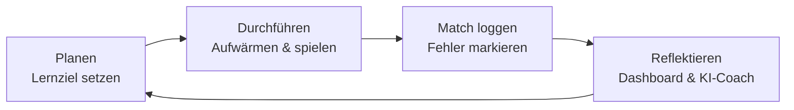

# Marvel Rivals Coach :material-controller:

Besser werden in einem Spiel funktioniert nach denselben Prinzipien wie jedes andere Lernen:
**Ziele setzen, gezielt üben, reflektieren.** Der *Rivals Coach* ist eine kleine Web-App, die dich
genau dabei unterstützt – und zeigt, wie KI-Tools als persönlicher Coach eingesetzt werden können.

[Rivals Coach öffnen :material-open-in-new:](app/){ .md-button .md-button--primary target="_blank" }

## Was die App kann

| Bereich | Wofür |
|---|---|
| **Trainingsplan** | 56 Trainingstage in 5 Phasen mit Nachlesen, Start, Spielblöcken, Review und Notizen; Themen-Tracker mit Wiederholungstagen, Drills, Kennzahlen-Vergleich aus deinen Matches (mit Ult-Wirkung) und ein Wochenpaket für den KI-Coach. Jeder Tag hat die Karte „Heute zählt nur das“ (neues Thema, kurzer Auffrischen-Check, wann Früheres von selbst wiederkommt, dein Abschluss von gestern). Die Matchlänge rechnet die App standardmässig mit 7 bis 12 Minuten (Quick Matches), du kannst den Bereich im Plan ändern; die Zeitangabe pro Block (3 Matches) rechnet sich daraus |
| **Tägliche Lektionen** | 35 Lektionen in 7 Modulen – jeden Tag eine: verstehen, Wissens-Check, üben, im Match anwenden, reflektieren; mit Wiederholungsfragen und Empfehlungen passend zu deinen Fehlern |
| **Dashboard** | Winrate, KDA, Verlauf, heutige Session, Angstgegner und automatische Coach-Hinweise |
| **Match loggen** | Ergebnis, K/D/A, Schaden, Heilung, Geblockt, Dauer, eingesetzte Ults und Ults mit Wirkung (teilweise zählt 0,5), Map, Datum, dein Team und das Gegnerteam, „Wer hat mir Probleme gemacht?“, Fehler und Stärken; dazu Coach-Hinweise, warum das Match gewonnen oder verloren gegangen sein könnte. Falsche Einträge (z.B. Sieg statt Niederlage) korrigierst du im Match-Verlauf per Klick |
| **Auswertung** | Schaden, Heilung und Geblockt pro 10 Minuten (wie im Spiel, nach Held und Siege vs. Niederlagen) und Ult-Wirkung, Winrate gegen jeden Gegner-Helden mit Counter-Tipp, Mitspieler, gegnerische Team-Stile, Maps, Tageszeit, Matches am Stück, Siege vs. Niederlagen |
| **Team & Counter** | Gegnerteam eintragen: Counter-Picks, Tipps „So spielst du dagegen“ für jeden Helden, Team-Aufstellungen (2-2-2, 1-3-2, 2-1-3, 3-1-2) mit Wann & Warum, Spielstile und aktuelle Meta-Picks |
| **Quiz** | Counter-Training (Spielstile, Helden-Duelle, Ult-Konter) und Wissens-Check zu den 30 Support-Themen, mit 16 Bildfragen (Position wählen, Heilziel, Dive, Fluchtweg, Ult-Zeitpunkt, Kill-Feed lesen, Kartenposition, Vorhalten beim Heilen und mehr); falsch beantwortete Fragen kommen häufiger, die Schwierigkeit steigt mit deiner Lernstufe |
| **Lexikon** | Support-Wissen (30 Einträge, zu jedem ein Lernbild: Hebel, Positionierung, Fluchtweg, Heal-Priorität, Ults, Dive, Kompositionen, Karten, Heal-Aim, Pings, Kill-Feed, Tilt und mehr, nach Lernstufe freigeschaltet; die Bilder passen sich Hell und Dunkel an). Jeder Eintrag erklärt zuerst einfach, zeigt dann eine Szene aus dem Match und die wichtigsten Begriffe. 75 Gamer-Begriffe (Peel, Dive, Poke, Cooldown …) sind im Text antippbar und erklären sich selbst, 14 davon mit Mini-Bild. Zu den Modi Domination, Convoy und Convergence gibt es Skizzen von oben (Schema mit Heilplätzen, Fluchtwegen, Flanken und Höhen, keine echten Karten), Ults & Konter (was jede Ult macht, wie man sie kontert und welche Helden sie konkret ausschalten) und ein Effekte-Lexikon (Betäubung, Blendung, Heilungsreduktion & Co.: Wirkung, Auslöser, Konter) |
| **Helden-Guide** | Alle 54 Helden (Stand Season 10, Oktober 2026): Grundregeln pro Rolle, Tipps, Spielstil-Tags, „Stark gegen / Gekontert von“, persönliche Matchup-Werte und Notizen |
| **Training** | Tägliche Routine mit Serien-Zähler, Übungen passend zu deinen häufigsten Fehlern und Problem-Gegnern, Aufwärm-Timer |
| **Lernziele** | SMARTe Ziele nach dem 3-Phasen-Modell: Planen, Durchführen, Reflektieren |
| **KI-Coach** | Erstellt aus deinen Daten einen fertigen Prompt für einen KI-Chatbot |
| **Daten & Sync** | Abgleich mit Rivals Data: In der Online-Version holt ein Sync-Helfer in Claude die Matches mehrmals täglich, die App übernimmt sie beim Öffnen (oder sofort per Knopf „Jetzt aktualisieren“); Backup als JSON, Export der Matches als CSV |

!!! info "Wo werden deine Daten gespeichert?"
    - **Online-Version** ([Rivals Coach auf claude.ai](https://claude.ai/artifact/A9BXPWjMR5zztNTyABsKnw)):
      Deine Einträge liegen privat in deinem Claude-Konto – nur du siehst sie, auf jedem Gerät, auf dem du angemeldet bist.
    - **Diese Website oder eine heruntergeladene Datei:** Die Daten bleiben nur in diesem Browser (`localStorage`).
      In Vorschau-Apps, im privaten Modus oder nach dem Löschen des Browserverlaufs gehen sie verloren.
      Oben rechts in der App siehst du jederzeit, wo gespeichert wird; ist Speichern nicht möglich, erscheint eine Warnung.

    Mit **Daten & Sync → Als JSON exportieren** erstellst du ein Backup, das du überall wieder importieren kannst –
    so überträgst du auch bisherige Daten in die Online-Version.

## Lernstufen: von den Grundlagen zum Expertenwissen

Der Rivals Coach steigert sich mit deinem Fortschritt in drei Stufen:

| Stufe | Wann | Was du bekommst |
|---|---|---|
| **1 · Grundlagen** | Trainingstag 1–21, Lektionen Modul 1–2 | Kern und Schritte jedes Themas, Übungen, einfache Fragen, Counter nach Spielstil |
| **2 · Aufbau** | Tag 22–35, Lektionen Modul 3–5 | dazu typische Fehler, Beispiele und Anwendungsfragen, Helden-Duelle im Counter-Quiz |
| **3 · Experte** | ab Tag 36, Lektionen Modul 6–7 | dazu die Experten-Stufe jedes Themas, schwere Szenario-Fragen und Ult-Konter im Quiz |

Es zählt immer die höhere Stufe aus Trainingsplan und Lektionen. Auf der Seite *Trainingsplan* kannst du die Stufe auch selbst festlegen.
Das Wissen stammt aus dem Plan „Solo-Support auf Celestial“; die persönliche Ausgangslage bleibt privat in deinem Konto.

## Abgleich mit Rivals Data

Statt jedes Match von Hand einzutragen, kannst du deine öffentlichen Matches von
[Rivals Data](https://rivalsdata.com) übernehmen. Rivals Data hat keine offizielle Schnittstelle und
blockiert direkte Abfragen aus dem Browser. Deshalb holt ein kleines Python-Skript die Daten ab:

**In der Online-Version** läuft das automatisch: Ein Sync-Helfer (eine eigene Claude-Sitzung) ruft das Skript
mehrmals täglich (etwa um 10, 14, 18 und 22 Uhr) auf und legt das Ergebnis in seinem Sitzungsprotokoll ab. Die App liest es beim Öffnen und
alle 20 Minuten, solange sie offen ist, und trägt neue Matches ein. Der Knopf **Jetzt aktualisieren** löst den
Abgleich sofort aus (meist 1–3 Minuten). Der Helfer schreibt nichts in deine App-Daten, das Schreiben bleibt bei der App.
Andernfalls geht es von Hand:

1. Python 3.10 oder neuer installieren, dann einmalig: `python -m pip install rivals-api`
2. [rivals_sync.py](rivals_sync.py) herunterladen.
3. Im selben Ordner ausführen: `python rivals_sync.py "DeinSpielername"`
4. Die erzeugte Datei `rivals-sync.json` in der App unter **Daten & Sync** importieren.

Importiert werden Held, Ergebnis, K/D/A, Map, Modus, Schaden, Heilung sowie die Helden beider Teams. Auch die Matchdauer kommt mit (damit rechnet die App Schaden, Heilung und Geblockt auf 10 Minuten um).
Nicht importiert werden können eingesetzte Ults und Ult-Wirkung: Die liefert Rivals Data nicht, die trägst du von Hand ein.
Neu importierte Matches erscheinen im Tab **Match loggen** unter „Neue Matches: Reflexion offen“, dort trägst du nur noch Fehler und Stärken ein.
Rivals Data zeigt nur die letzten etwa 20 Matches und hinkt dem Spiel teils um Stunden hinterher – frische
Matches trägst du am besten von Hand ein. Sie werden später mit dem Rivals-Data-Eintrag zusammengeführt,
wenn Datum, Held, Ergebnis und K/D/A übereinstimmen.
Bereits vorhandene Matches werden aktualisiert statt doppelt angelegt, und deine Notizen bleiben erhalten.
Zusätzlich lädt das Skript deine Helden-Statistik aus dem Profil und die globale Tierlist. Damit
vergleicht die App unter **Auswertung** deine Winrate pro Held mit dem Schnitt aller Spieler.

!!! warning "Inoffizielle Datenquelle"
    Das Skript nutzt die Community-Bibliothek [rivals-api](https://github.com/GS-Rionnag/rivals-api),
    die auf eine nicht dokumentierte Schnittstelle von Rivals Data zugreift. Diese kann sich jederzeit
    ändern. Deine Match-History muss im Spiel öffentlich sein.

## Tägliche Lektionen

Der Kern der App ist ein Kurs mit **35 kurzen Lektionen** (je 8–15 Minuten), aufgeteilt in sieben Module:
Fundament, Überleben & Positionierung, Teamfights, Objectives & Maps, Counter & Anpassung,
Rollen-Meisterschaft und Kopf & Fortschritt. Jede Lektion folgt fünf Schritten:

1. **Verstehen** – kurze Erklärung und ein Merksatz
2. **Wissens-Check** – Quizfragen, dazu Wiederholungsfragen aus früheren Lektionen
3. **Üben** – konkrete Übungen im Practice Range, im Custom Game oder im Match
4. **Anwenden** – ein Fokus für deine nächsten Matches, den du beim Loggen bewertest
5. **Reflektieren** – eine Frage zum Nachdenken

Die App schlägt dir jeden Tag die nächste Lektion vor, empfiehlt Lektionen passend zu deinen häufigsten
Fehlern und zeigt, ob sich nach einer Lektion zum Beispiel deine Tode verringert haben.

## So lernst du mit der App

1. **Planen:** Mach die heutige Lektion und lege im Tab *Lernziele* ein kleines, messbares Ziel fest – z.B. „Diese Woche als Strategist im Schnitt höchstens 5 Tode“.
2. **Durchführen:** Wärme dich mit dem Timer auf und spiele mit einem kleinen Hero-Pool (2–3 Helden pro Rolle).
3. **Loggen:** Trage jedes Match direkt danach ein. Ehrlich markierte Fehler sind der wertvollste Teil.
4. **Reflektieren:** Schau dir nach jeder Session das Dashboard und die Auswertung an. Der Coach erkennt Muster wie
   „In Niederlagen stirbst du deutlich öfter“ oder „Gegen Spider-Man gewinnst du nur 30 %“ und schlägt passende Übungen und Counter vor.

## Counter lernen

Counter beruhen in der App auf **Spielstil-Tags** (z.B. *Dive*, *Flyer*, *Hitscan*, *AntiDive*) und einfachen
Faustregeln – etwa „Flyer werden von Hitscan-Helden gekontert“ oder „Diver werden von Anti-Dive-Fähigkeiten bestraft“.
So lernst du nicht nur auswendig, *wer* wen kontert, sondern verstehst, *warum*. Je mehr Matches du mit Gegnerteam
loggst, desto stärker fliessen deine eigenen Erfahrungen in die Vorschläge ein. Da sich das Balancing mit jeder Season
ändert, kannst du die Tags im Helden-Guide jederzeit anpassen.

## KI als Coach nutzen

Im Tab *KI-Coach* fasst die App deine Statistik, Fehler, Notizen und Ziele zu einem Prompt zusammen.
Diesen kannst du in einen KI-Chatbot wie [ChatGPT](../tools/chatgpt.md) kopieren und dir Feedback
oder einen Trainingsplan geben lassen. Tipps zum Formulieren guter Prompts findest du im
[Prompt-Engineering-Guide](../guides/prompt-engineering.md).

!!! warning "Kritisch bleiben"
    KI-Chatbots kennen oft nicht den aktuellen Patch-Stand und können sich bei Helden-Fähigkeiten irren.
    Nutze die Antworten als Denkanstoss und überprüfe sie im Spiel – genau wie bei jeder anderen KI-Anwendung.
