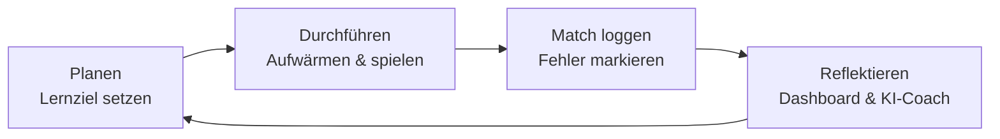

# Marvel Rivals Coach :material-controller:

Besser werden in einem Spiel funktioniert nach denselben Prinzipien wie jedes andere Lernen:
**Ziele setzen, gezielt üben, reflektieren.** Der *Rivals Coach* ist eine kleine Web-App, die dich
genau dabei unterstützt – und zeigt, wie KI-Tools als persönlicher Coach eingesetzt werden können.

[Rivals Coach öffnen :material-open-in-new:](app/){ .md-button .md-button--primary target="_blank" }

## So ist die App aufgebaut

Die App hat **fünf Bereiche**, damit du den Überblick behältst. Am Handy stehen sie als Leiste unten, am Computer oben, darunter die Unterseiten des jeweiligen Bereichs.

| Bereich | Unterseiten |
|---|---|
| **Heute** | Dein Tag in vier Schritten: Lektion, Training, Wochenziel, Spielen. Dazu Neues bei deinen Helden und „Erste Schritte“ für Neue |
| **Lernen** | Trainingsplan, Lektionen, Quiz, Helden-Bootcamp, Lexikon (mit den Spielregeln) |
| **Spielen** | Match loggen, Auswertung, Überblick |
| **Helden** | Helden-Guide, Team & Counter, Team-Ups, Meta & Patch |
| **Coach** | Lernziele, Training, KI-Coach, Daten & Sync |

Mit der **Suche** (Lupe oben oder Taste `/`, `Strg+K`) findest du Seiten, Helden (auch unter Spitznamen), Lektionen, Begriffe, Team-Ups und Patch-Einträge. Lange Seiten wie der Trainingsplan haben **einklappbare Karten**: Offen ist, was du jetzt brauchst (zum Beispiel die aktuelle Phase), der Rest bleibt zu. Die App merkt sich, was du geöffnet hast.

## Was die App kann

| Bereich | Wofür |
|---|---|
| **Trainingsplan** | 56 Trainingstage in 5 Phasen mit Nachlesen, Start, Spielblöcken, Review und Notizen; Themen-Tracker mit Wiederholungstagen, Drills, Kennzahlen-Vergleich aus deinen Matches (mit Ult-Wirkung) und ein Wochenpaket für den KI-Coach. Jeder Tag hat die Karte „Heute zählt nur das“ (neues Thema, kurzer Auffrischen-Check, wann Früheres von selbst wiederkommt, dein Abschluss von gestern). Du wählst deine **Hauptrolle** und einen **Helden-Pool** mit bis zu sechs Helden aus beliebigen Rollen (ein Rollenwechsel löscht den Pool nicht): Die Beispielhelden in den Tagesplänen werden durch deine Helden ersetzt, die der Hauptrolle zuerst. Für die beiden anderen Rollen (Flex) ist ein Pool-Held vorgewählt. Blöcke, die du an einem Tag nicht schaffst, schiebt die App automatisch auf den nächsten freien Tag (höchstens einer pro Tag, der Rest wird als „Nachholen“ gesammelt). Wo der Plan „schreib auf“ oder „notier“ sagt, steht das Eintragsfeld direkt im Block, und das Mini-Ziel für Block 3 wählst du selbst. Ein Block ist etwa eine Stunde Übungszeit (einstellbar). **Zwischenstopps in den Blöcken:** Vor Block 1 eine Abruf-Frage (erst überlegen, dann nachschauen, dann bewerten), nach Block 1 ein Tipp zu deinem Helden, deinem Team-Up oder einer Karte mit eigenem Wenn-dann-Satz, nach Block 2 die Frage „Warum geht das schief?“. Am Tagesende hilft ein „Rückblick in drei Fragen“, und der Vorsatz erscheint am nächsten Tag oben. **Aufgaben haken sich automatisch ab:** Die App zählt mit, was du tust. Block 1 bis 3 im Plan gelten als erledigt, sobald die Matches des Blocks heute geloggt sind (bei 6 Matches pro Block zum Beispiel 6, 12 und 18). Schritte mit Eintragsfeldern, sobald alle Felder ausgefüllt sind. In den Lektionen und in der täglichen Routine erkennt die App zum Beispiel „Beantworte 10 Quizfragen“, „Spiele ein Domination-Match“, „Spiele ein Match als Vanguard“, „Lege ein Ziel an“ oder „Logge dein nächstes Match vollständig“. Daneben steht ein Vermerk „automatisch“ mit dem Fortschritt (zum Beispiel „7 von 10 Fragen“). Ein Häkchen, das du selbst setzt oder wegnimmst, bleibt immer so Die App rechnet standardmässig mit Matches von 7 bis 12 Minuten (Quick Matches, änderbar) und zeigt dafür 6 statt 3 Matches pro Block; die Match-Nummern in den Tagesplänen werden automatisch umgerechnet. Am Tagesende bewertest du pro Thema „Sitzt es?“ (noch denken, meistens, läuft von allein), der Themen-Tracker zeigt den Stand | **Grundregeln:** Jedes Thema wird zur Grundregel, sobald sein erster Tag erledigt ist. Auf «Heute» stehen bis zu vier, zuerst die, bei denen du «muss ich noch denken» angegeben hast. Im Match-Log fragt die App dazu: «Hast du daran gedacht, ohne es dir vorzunehmen?» (Ja, von selbst / Ja, bewusst / Nein). Ab drei Antworten zählen die letzten fünf mehr als dein Gefühl am Tagesende: Eine Regel verschwindet, wenn sie meist von selbst klappt, und kommt bei drei «Nein» zurück. Läuft alles von allein, fragt die App ab und zu als Stichprobe. **Weniger Hilfe:** Ab Tag 43 sind die Aufgabentexte gekürzt («mehr» zeigt den Rest), ab Tag 50 steht der Rest unter «Weitere Hinweise» und die Grundregeln nur noch als Stichworte. Aufgaben mit Eintragsfeld bleiben ganz. Mit «Immer ausführlich» schaltest du das ab. **Modus pro Block:** Der Plan nennt den Modus pro Tag (Ranked, ungewertet, «ungewertet, dann Ranked» …). Jeder Block trägt dazu ein Abzeichen, und «Heute zählt nur das» fasst es zusammen, zum Beispiel «Block 1: Ungewertet · Block 2 und 3: Ranked · ab Block 4: ungewertet oder Replay». Abgeleitet ist das aus den Regeln des Plans: Neues zuerst ungewertet, in Ranked nur, was schon sitzt, ab Block 4 eher ungewertet oder Replays. Hast du an einem Ranked-Tag nur ungewertete Matches geloggt, weist die App darauf hin.
| **Tägliche Lektionen** | 38 Lektionen in 7 Modulen: verstehen, Wissens-Check, üben, im Match anwenden, reflektieren; mit Wiederholungsfragen und Empfehlungen passend zu deinen Fehlern. Die Lektionen laufen Hand in Hand mit dem Trainingsplan: Jeder Trainingstag hat seine Tageslektion (dazu freiwillige Vertiefungen), im Tag steht die Karte „Lektion zum Tag“, bei den Lektionen siehst du, zu welchen Tagen sie gehören und was aus früheren Tagen noch offen ist |
| **Überblick** | Winrate, KDA, Verlauf, Angstgegner und automatische Coach-Hinweise gleich oben; Lernpfad und Flex-Training sind einklappbar. Die heutige Session erscheint, sobald du gespielt hast |
| **Alle Rollen (Flex-Training)** | Karte im Dashboard: Matches, Winrate, Tode und Helden pro Rolle (Support, Tank, DPS), deine Marke (Standard 10 Matches und 2 Helden pro Rolle, änderbar), Flex-Held pro Rolle, nächster Schritt mit Ziel aus den Lektionen L20 und L21. Im Trainingsplan entscheidest du jeden Tag selbst, ob du zusätzlich Tank oder DPS lernst oder nur bei Support bleibst (Wahl pro Tag, mit Vorschlag der App), und beim Loggen eines Tank- oder DPS-Matches erscheint ein Hinweis |
| **Match loggen** | Ergebnis, K/D/A, Schaden, Heilung, Geblockt, Dauer, eingesetzte Ults und Ults mit Wirkung (teilweise zählt 0,5), Map, Datum, dein Team und das Gegnerteam, „Wer hat mir Probleme gemacht?“, Fehler und Stärken; dazu Coach-Hinweise, warum das Match gewonnen oder verloren gegangen sein könnte. Falsche Einträge (z.B. Sieg statt Niederlage) korrigierst du im Match-Verlauf per Klick. Der **Todesursachen-Tracker** zählt pro Match, woran du gestorben bist: Jede Ursache hat einen Knopf, den du so oft drückst, wie es passiert ist (zum Beispiel dreimal „Zu weit vorne beim Heilen“). Die Ursachen passen zu deiner Rolle, die Fehler-Auswahl zusätzlich zu deinem Helden (mit seinen Fähigkeiten). Die Zähler fliessen in Auswertung, Überblick, Coach-Hinweise, Übungen und Lektionsempfehlungen ein. Auch bei einem Sieg fragt die App, was noch besser gewesen wäre (Heldenwahl, Teamzusammenstellung) |
| **Auswertung** | Schaden, Heilung und Geblockt pro 10 Minuten (wie im Spiel, nach Held und Siege vs. Niederlagen) und Ult-Wirkung, Winrate gegen jeden Gegner-Helden mit Counter-Tipp, Mitspieler, gegnerische Team-Stile, Maps, Tageszeit, Matches am Stück, Siege vs. Niederlagen |
| **Team & Counter** | Oben steht das aktuelle Match (das, das du gerade eingibst, sonst dein letztes; ältere wählst du aus), darunter dein Team und das Gegnerteam, danach die Probleme und Gegenmassnahmen. Gegnerteam eintragen: Counter-Picks, Tipps „So spielst du dagegen“ für jeden Helden, Team-Aufstellungen (2-2-2, 1-3-2, 2-1-3, 3-1-2) mit Wann & Warum, Spielstile und aktuelle Meta-Picks. Neu: **Teams lesen** (beide Teams im Überblick: Aufstellung, Spielstil-Tags, wer auf die Backline geht, Heilungsreduktion, mögliche Team-Ups, was deinem Team fehlt) und der **Support-Wechsel-Berater** (drei feste Fragen, dann die vier Strategists mit den meisten belegten Argumenten: Ult-Konter, Team-Up mit deinem Team, Synergien, schwierige Gegner, zuletzt Tag-Faustregeln, jeweils mit Grund und Vorsicht-Hinweis). Die Rangliste ist eine Denkhilfe, keine Garantie. Dazu das Quiz „Lage lesen“ (Helden und Karten) und Hinweise im Trainingsplan an den Swap-Tagen. **In vier Schritten:** Die Seite zeigt zuerst nur Schritt 1 (Eintragen), dann Schritt 2 (Lage lesen), 3 (Wechsel prüfen) und 4 (Nachschlagen: Aufstellungen, Spielstile, Meta-Picks); mit «Alles zeigen» siehst du wie früher alle Karten gleichzeitig |
| **Helden-Bootcamp** | Ein eigener Kurs für jeden der 56 Helden mit Profil (auch die drei Deadpool-Profile). Sieben Stationen, zusammen etwa 30 Minuten, in beliebig vielen Sitzungen: 1 Vorwissen, 2 Fähigkeiten, 3 Die Ult, 4 Gegner und Team, 5 Stärken und Fehler, 6 Mein Steckbrief, 7 Abschlusstest. In den Stationen 1 bis 5 schreibst du erst deine Antwort aus dem Kopf auf, vergleichst dann mit den Quellen (Heldenprofil: Fähigkeiten, Ult-Einsatz und Konter, Gegner, Synergien, Team-Ups, Schwächen, Tipps und deine eigenen Zahlen und Fehler mit dem Helden) und wirst danach abgefragt; die Fragen erzeugt die App aus denselben geprüften Daten und stellt sie zusammen mit den Texten nie gleichzeitig. Jede Antwort läuft durch das Wiederholungs-System (1, 2, 4, 8, 16, 32 Tage, falsch: morgen) mit Sicherheits-Einschätzung und zählt für die automatischen Aufgaben im Plan. In Station 6 schreibst du Rolle, Stärken, Ult-Moment und Gefahren aus dem Kopf auf, setzt ein Wenn-dann-Mini-Ziel und vergleichst mit den Quellen. Der Test hat bis zu 10 Fragen und gilt ab 80 % als bestanden (beliebig oft wiederholbar); danach folgt der Praxis-Auftrag „3 Matches mit dem Helden“, den die App aus deinen geloggten Matches selbst erkennt. Fällige Wiederholungen bietet der Kurs als „Auffrischen“ an. Aus dem Helden-Guide kommst du mit einem Button direkt in den Kurs. Die Methoden stammen aus Studien in Schule und Labor, nicht aus Videospielen |
| **Quiz** | Counter-Training (Spielstile, Helden-Duelle, Ult-Konter), Wissens-Check zu den 30 Support-Themen und **Helden und Karten**: rund 800 Fragen, die die App selbst aus den geprüften Heldendaten erzeugt (Ult-Namen, Fähigkeiten, Ult-Konter, typische Fehler, Stärken und Schwächen, Karten, Team-Ups, „Lage lesen“ gegen ein Gegnerteam, Fähigkeit zur Beschreibung innerhalb eines Helden, Stärken), immer mit Erklärung, Quelle und Stand. Alle drei Quiz-Arten fragen vorab, wie sicher du bist, und planen falsch beantwortete Fragen für morgen ein, gewusste für später. Der Wissens-Check mit 16 Bildfragen (Position wählen, Heilziel, Dive, Fluchtweg, Ult-Zeitpunkt, Kill-Feed lesen, Kartenposition, Vorhalten beim Heilen und mehr); falsch beantwortete Fragen kommen häufiger, die Schwierigkeit steigt mit deiner Lernstufe |
| **Lexikon** | Support-Wissen (30 Einträge, zu jedem ein Lernbild: Hebel, Positionierung, Fluchtweg, Heal-Priorität, Ults, Dive, Kompositionen, Karten, Heal-Aim, Pings, Kill-Feed, Tilt und mehr, nach Lernstufe freigeschaltet; die Bilder passen sich Hell und Dunkel an). Jeder Eintrag erklärt zuerst einfach, zeigt dann eine Szene aus dem Match und die wichtigsten Begriffe. 75 Gamer-Begriffe (Peel, Dive, Poke, Cooldown …) sind im Text antippbar und erklären sich selbst, 14 davon mit Mini-Bild. Der Reiter **Spielregeln** erklärt Ränge, Bans (ab Gold 3, Reihenfolge 1-2-2-1), Strafen, Aufstellung, Modi, Ult-Energie, Pings und den Ablauf eines Matches, jeweils mit Quelle und Stand, dazu Besonderheiten und Tipps für 18 Karten (Wege, Heilpakete, Flankenrouten; im Team-&-Counter-Tab erscheint die Karte deines aktuellen Matches). Zu den Modi Domination, Convoy und Convergence gibt es Skizzen von oben (Schema mit Heilplätzen, Fluchtwegen, Flanken und Höhen, keine echten Karten), Ults & Konter (was jede Ult macht, wie man sie kontert und welche Helden sie konkret ausschalten) und ein Effekte-Lexikon (Betäubung, Blendung, Heilungsreduktion & Co.: Wirkung, Auslöser, Konter) |
| **Helden-Guide** | Alle 54 Helden (Stand Season 10.5, Oktober 2026): Grundregeln pro Rolle, Tipps, Spielstil-Tags, „Stark gegen / Gekontert von“, persönliche Matchup-Werte und Notizen. Für alle 56 Helden (Deadpool zählt dreimal, einmal pro Rolle) gibt es geprüfte Profile (Rolle im Team, Stärken, Schwächen, Tipps, alle Fähigkeiten, Änderungen seit Season 10; was nicht sicher belegt ist, steht dabei) und dazu „Ult richtig einsetzen und kontern“: wann und wo die Ult am meisten bringt, was du dabei vermeiden solltest und wer sie belegt kontert, dazu bei jedem Helden seine zwei Team-Ups. Die Heldensuche (auch beim Auswählen im Match-Log) kennt Spitznamen und Abkürzungen wie Wanda, Bucky oder C&D; eigene ergänzt du pro Held |
| **Team-Ups** | Das System seit Season 9: Jeder Held wählt eines von zwei Team-Ups, die Grundwirkung gilt immer, die Verstärkung braucht den Partner im Team. Standardmässig siehst du die Team-Ups deiner Helden, mit Suche über alle 108 und Filter „in Season 10.5 angepasst“ |
| **Meta & Patch** | Nur, was deine Heldenwahl betrifft: deine Helden mit ihren Änderungen, Balance-Änderungen von Season 10 und 10.5 mit Filtern, Tierlisten (als Einschätzung von marvelrivals.gg gekennzeichnet) und Pick-, Win- und Banrate aus einer Stichprobe. Jede Angabe nennt Quelle und Stand |
| **Training** | Tägliche Routine mit Serien-Zähler, Übungen passend zu deinen häufigsten Fehlern und Problem-Gegnern, Aufwärm-Timer |
| **Lernziele** | Wochenziele in eigenen Worten (zum Beispiel „Weniger sterben“). Die App erkennt das Thema, wählt passende Lektionen aus, stellt Aufgaben für die Woche zusammen und zeigt deinen Fortschritt aus den Matches (Tode, Heilung pro 10 Minuten, Ult-Wirkung, Rollen-Flex). Das Ziel erscheint auch im Trainingstag, im Dashboard und im Training; Vorschläge kommen aus deinen häufigsten Fehlern. Nach dem 3-Phasen-Modell: Planen, Durchführen, Reflektieren |
| **KI-Coach** | Erstellt aus deinen Daten einen fertigen Prompt für einen KI-Chatbot |
| **Daten & Sync** | Abgleich mit Rivals Data: In der Online-Version holt ein Sync-Helfer in Claude die Matches mehrmals täglich, die App übernimmt sie beim Öffnen (oder sofort per Knopf „Jetzt aktualisieren“); Backup als JSON, Export der Matches als CSV |

!!! info "Wo werden deine Daten gespeichert?"
    - **Online-Version** ([Rivals Coach auf claude.ai](https://claude.ai/artifact/A9BXPWjMR5zztNTyABsKnw)):
      Deine Einträge liegen privat in deinem Claude-Konto – nur du siehst sie, auf jedem Gerät, auf dem du angemeldet bist.
    - **Diese Website oder eine heruntergeladene Datei:** Die Daten bleiben nur in diesem Browser (`localStorage`).
      In Vorschau-Apps, im privaten Modus oder nach dem Löschen des Browserverlaufs gehen sie verloren.
      Oben rechts in der App siehst du jederzeit, wo gespeichert wird; ist Speichern nicht möglich, erscheint eine Warnung.

    Mit **Daten & Sync → Als JSON exportieren** erstellst du ein Backup, das du überall wieder importieren kannst –
    so überträgst du auch bisherige Daten in die Online-Version.

## Lernstufen: von den Grundlagen zum Expertenwissen

Der Rivals Coach steigert sich mit deinem Fortschritt in drei Stufen:

| Stufe | Wann | Was du bekommst |
|---|---|---|
| **1 · Grundlagen** | Trainingstag 1–21, Lektionen Modul 1–2 | Kern und Schritte jedes Themas, Übungen, einfache Fragen, Counter nach Spielstil |
| **2 · Aufbau** | Tag 22–35, Lektionen Modul 3–5 | dazu typische Fehler, Beispiele und Anwendungsfragen, Helden-Duelle im Counter-Quiz |
| **3 · Experte** | ab Tag 36, Lektionen Modul 6–7 | dazu die Experten-Stufe jedes Themas, schwere Szenario-Fragen und Ult-Konter im Quiz |

Es zählt immer die höhere Stufe aus Trainingsplan und Lektionen. Auf der Seite *Trainingsplan* kannst du die Stufe auch selbst festlegen.
Das Wissen stammt aus dem Plan „Solo-Support auf Celestial“; die persönliche Ausgangslage bleibt privat in deinem Konto.

## Lernmethoden hinter der App

Die App stützt sich auf Methoden, die in der Lernforschung gut belegt sind. Sie sind nicht einfach „schöner Zusatz“, sondern der Grund, warum der Plan so aufgebaut ist.

| Methode | Wo du sie in der App findest | Kurz erklärt |
|---|---|---|
| **Abrufen statt nachlesen** | Zwischenstopp „Abruf“, Wissens-Check, Quiz in den Lektionen | Wer sich selbst abfragt, behält mehr als wer nur liest (Roediger & Karpicke, 2006). Bei den Zwischenstopps schreibst du deine Antwort zuerst auf, dann erst siehst du die richtige |
| **Wiederholen mit wachsendem Abstand** | Plan (Themen kommen nach 1, 3 und 7 Tagen wieder), Wiederholungs-System (1, 2, 4, 8, 16, 32 Tage), „Heute“ zeigt, was fällig ist | Verteiltes Lernen schlägt Büffeln (Cepeda et al., 2006). Gewusst: der Abstand wächst. Nicht gewusst: schon morgen wieder |
| **Mischen statt am Block üben** | Tages-Check mischt Fragen von heute und früheren Tagen | Das fühlt sich schwerer an, hilft aber, das richtige Vorgehen auszuwählen (Rohrer & Taylor, 2007) |
| **Vorab-Fragen** | Zwischenstopp „Vorab-Frage“ vor einem neuen Thema | Schon ein Rateversuch vor dem Lesen bereitet das Lernen vor (Richland, Kornell & Kao, 2009) |
| **Sicherheit einschätzen** | Wissens-Check („Wie sicher bist du?“) | Du siehst, wie gut du dich einschätzt. Fehler, bei denen man sich sicher war, werden nach der Korrektur oft besonders gut behalten (Butterfield & Metcalfe, 2001) |
| **Sich selbst etwas erklären** | „Warum geht das schief?“, Rückblick in drei Fragen | Eigene Erklärungen vertiefen das Verständnis; Dunlosky et al. (2013) stufen das als nützlich ein, Abfragen und Verteilen sogar als besonders nützlich |
| **Wenn-dann-Sätze** | Zwischenstopp „Wusstest du?“, Rückblick (Vorsatz für morgen) | „Wenn X passiert, dann tue ich Y“ erhöht die Chance, dass ein Vorsatz umgesetzt wird (Gollwitzer & Sheeran, 2006) |
| **Planen, durchführen, reflektieren** | Aufbau der Lektionen und der Trainingstage, Wochenziele | Der Kreislauf des selbstgesteuerten Lernens (Zimmerman, 2002) |
| **Gezielte Übung mit Rückmeldung** | Mini-Ziel pro Block, Todesursachen-Tracker, Auswertung | Üben mit einem klaren Ziel und Feedback gilt in Musik und Sport als Weg zur Meisterschaft (Ericsson et al., 1993). Für Esport ist das nicht bestätigt, siehe unten |

### Was die Forschung speziell zu Videospielen sagt

Die Forschung zu Lernen in Spielen ist jung und dünn. Das Wichtigste, was ich dazu gefunden und geprüft habe:

- **Regelmässig, mit Abstand üben.** In Daten von über 850'000 Spielerinnen und Spielern eines Online-Tests für Wahrnehmung und Reaktion hing das Ergebnis davon ab, wie viel und wie verteilt geübt wurde. Wer früh unterschiedlich spielte und ausprobierte, verbesserte sich im Schnitt mehr (Stafford & Dewar, 2014). Eine zweite Auswertung mit über 1,2 Millionen Spielern bestätigte den Vorteil von verteiltem Üben, fand aber keinen zusätzlichen Gewinn durch eine Nacht Schlaf in der Pause (Stafford & Haasnoot, 2017).
- **Ohne lange Pausen.** Bei StarCraft 2 lernten Spieler mit mässiger Spielhäufigkeit und ohne lange Pausen am schnellsten; die Besten verbesserten sich ohne Einbrüche und begannen Matches mit festen Routinen (Huang et al., 2017). Das sind Beobachtungen, kein Beweis für Ursache und Wirkung.
- **Gezielte Übung: nicht bestätigt.** In einer vorab registrierten Studie mit Spielern von Counter-Strike (186) und League of Legends (411) hing die Selbstauskunft zu gezielter Übung nicht mit der Leistung zusammen. Bei League of Legends sagten die normalen Spielstunden etwas voraus, und jüngere Spieler waren besser (Martončik et al., 2024). Die Studie ist eine Momentaufnahme mit Selbstauskünften. Sie widerlegt den Nutzen von Ziel und Rückmeldung nicht, zeigt aber, dass er bei Spielen nicht einfach vorausgesetzt werden darf. Die App behandelt Mini-Ziele deshalb als Hilfe, nicht als Garantie.
- **Rückmeldung nicht als Krücke.** Eine Zusammenfassung von 20 Studien zu Bewegungsfertigkeiten fand: Zusätzliche Rückmeldung hilft während des Übens, aber der Vorteil schwindet, wenn sie wegfällt (Jiménez-Díaz et al., 2020). Für Videorückmeldung allein ist der Effekt klein. Darum übst du auch ohne Hilfen und ohne Pings, nicht nur mit ihnen.
- **Tilt.** Die Forschung dazu ist früh. Genannt werden Frust nach Niederlagen oder Fehlern von Mitspielern, und als wichtigste Fähigkeit das Regulieren von Gefühlen (Beres et al., 2023, Übersichtsarbeit). Welche Methoden wirklich helfen, ist offen.
- **Coaching.** Interviews mit 14 Cheftrainern professioneller League-of-Legends-Teams zeigen einen Kreislauf aus Rückblick, Planen und Tun unter Siegesdruck (Sports Coaching Review, 2025). Das beschreibt die Praxis, es misst nicht die Wirkung.
- **Vorstellungstraining.** Eine Studie mit 45 Esport-Spielern, die Vorstellungstraining mit normalem Üben verband, berichtet bessere Reaktionszeiten. Die Belege sind klein und noch nicht gesichert, deshalb ist das nicht in der App.

!!! note "Was das nicht beweist"
    Diese Studien stammen aus Schule, Studium und Labor, nicht aus Untersuchungen zu Videospielen. Dass die Methoden auch für Marvel Rivals funktionieren, ist plausibel, aber nicht einzeln bewiesen. Die Zahlen zu Intervallen (1, 2, 4, 8, 16, 32 Tage) sind eine gängige Faustregel, keine Garantie.

## Abgleich mit Rivals Data

Statt jedes Match von Hand einzutragen, kannst du deine öffentlichen Matches von
[Rivals Data](https://rivalsdata.com) übernehmen. Rivals Data hat keine offizielle Schnittstelle und
blockiert direkte Abfragen aus dem Browser. Deshalb holt ein kleines Python-Skript die Daten ab:

**In der Online-Version** läuft das automatisch: Ein Sync-Helfer (eine eigene Claude-Sitzung) ruft das Skript
mehrmals täglich (alle zwei Stunden von 10 bis 22 Uhr, jeweils kurz nach der vollen Stunde) auf und legt das Ergebnis in seinem Sitzungsprotokoll ab. Die App liest es beim Öffnen und
alle 20 Minuten, solange sie offen ist, und trägt neue Matches ein. Der Knopf **Jetzt aktualisieren** löst den
Abgleich sofort aus (meist 1–3 Minuten). Der Helfer schreibt nichts in deine App-Daten, das Schreiben bleibt bei der App.
Klappt der automatische Abgleich nicht (zum Beispiel weil die Verbindung zu Claude für die Seite nicht erlaubt ist), zeigt die App
oben einen Hinweis mit dem Grund und einen Knopf **Berechtigungen öffnen**. Unter **Daten & Sync** steht immer, wann zuletzt abgerufen wurde.
Andernfalls geht es von Hand:

1. Python 3.10 oder neuer installieren, dann einmalig: `python -m pip install rivals-api`
2. [rivals_sync.py](rivals_sync.py) herunterladen.
3. Im selben Ordner ausführen: `python rivals_sync.py "DeinSpielername"`
4. Die erzeugte Datei `rivals-sync.json` in der App unter **Daten & Sync** importieren.

Importiert werden Held, Ergebnis, K/D/A, Map, Modus, Schaden, Heilung sowie die Helden beider Teams. Auch die Matchdauer kommt mit (damit rechnet die App Schaden, Heilung und Geblockt auf 10 Minuten um).
Nicht importiert werden können eingesetzte Ults und Ult-Wirkung: Die liefert Rivals Data nicht, die trägst du von Hand ein.
Neu importierte Matches erscheinen im Tab **Match loggen** unter „Neue Matches: Reflexion offen“, dort trägst du nur noch Fehler und Stärken ein.
Rivals Data zeigt nur die letzten etwa 20 Matches und hinkt dem Spiel teils um Stunden hinterher – frische
Matches trägst du am besten von Hand ein. Sie werden später mit dem Rivals-Data-Eintrag zusammengeführt,
wenn Datum, Held, Ergebnis und K/D/A übereinstimmen.
Bereits vorhandene Matches werden aktualisiert statt doppelt angelegt, und deine Notizen bleiben erhalten.
Zusätzlich lädt das Skript deine Helden-Statistik aus dem Profil und die globale Tierlist. Damit
vergleicht die App unter **Auswertung** deine Winrate pro Held mit dem Schnitt aller Spieler.

!!! warning "Inoffizielle Datenquelle"
    Das Skript nutzt die Community-Bibliothek [rivals-api](https://github.com/GS-Rionnag/rivals-api),
    die auf eine nicht dokumentierte Schnittstelle von Rivals Data zugreift. Diese kann sich jederzeit
    ändern. Deine Match-History muss im Spiel öffentlich sein.

## Die App langsam kennenlernen

Die App ist gross. Damit sie am Anfang nicht überfordert, führt sie dich in kleinen Schritten:

- **«So liest du diese Seite»** steht oben auf Heute, Trainingsplan, Match loggen, Auswertung, Team & Counter, Helden-Guide und Quiz. Bei den ersten zwei Besuchen ist die Karte offen, danach klappt sie von selbst zu (jederzeit wieder zu öffnen).
- **App-Übungen** auf «Heute»: elf kleine Aufgaben, immer nur die nächste und die übernächste sichtbar (erstes Match loggen, Fehler und Stärken festhalten, Team & Counter Schritt 1 bis 3, Held nachschlagen, fünf Quizfragen, Grundregeln beantworten, Bootcamp-Station 1, Auswertung lesen, Backup). Die App erkennt selbst, was du schon gemacht hast; mit «Überspringen» oder «Übungen ausblenden» schaltest du sie ab.
- **Team & Counter in vier Schritten** (siehe oben).

Das erklärt nur, wie die App aufgebaut ist. Neue Spielfakten kommen dabei nicht dazu.

## App weitergeben

Die App ist eine einzige HTML-Datei (`app/index.html`) ohne Server. Jede Person, die sie öffnet, hat ihre **eigenen**
Daten im eigenen Browser (Matches, Plan, Notizen). Über *Daten & Sync → Als JSON exportieren* lässt sich alles als Datei sichern
und auf einem anderen Gerät wieder einlesen (*Backup importieren*).

- Die öffentliche Datei enthält keine persönlichen Werte: keinen Artifact-Link und keine Sync-Sitzung. Der automatische
  Abgleich im Hintergrund ist deshalb nur in der privaten Version aktiv.
- Freunde gleichen ihre Matches wie oben beschrieben mit dem Skript `rivals_sync.py` ab (Tab *Daten*).
- `python3 app_build.py file` baut eine eigenständige Datei zum Verschicken (`artifact/rivals-coach-fuer-freunde.html`),
  `python3 app_build.py friends` die gleiche Version für ein eigenes Artifact. Beide enthalten keine Heldenbilder
  und keine privaten Werte. Die Heldenbilder gehören Marvel/NetEase und werden nicht weitergegeben; die App zeigt
  dann Initialen mit Rollenring.
- Deine privaten Werte (`private.json`) und die Bilder (`hero_img.json`) stehen in der `.gitignore` und landen nie im Repo.

## Tägliche Lektionen

Der Kern der App ist ein Kurs mit **38 kurzen Lektionen** (je 8–15 Minuten), aufgeteilt in sieben Module:
Fundament, Überleben & Positionierung, Teamfights, Objectives & Maps, Counter & Anpassung,
Rollen-Meisterschaft und Kopf & Fortschritt. Jede Lektion folgt fünf Schritten:

1. **Verstehen** – kurze Erklärung und ein Merksatz
2. **Wissens-Check** – Quizfragen, dazu Wiederholungsfragen aus früheren Lektionen
3. **Üben** – konkrete Übungen im Practice Range, im Custom Game oder im Match
4. **Anwenden** – ein Fokus für deine nächsten Matches, den du beim Loggen bewertest
5. **Reflektieren** – eine Frage zum Nachdenken

Die App schlägt dir jeden Tag die nächste Lektion vor, empfiehlt Lektionen passend zu deinen häufigsten
Fehlern und zeigt, ob sich nach einer Lektion zum Beispiel deine Tode verringert haben.

## So lernst du mit der App

1. **Planen:** Mach die heutige Lektion und lege im Tab *Lernziele* ein kleines, messbares Ziel fest – z.B. „Diese Woche als Strategist im Schnitt höchstens 5 Tode“.
2. **Durchführen:** Wärme dich mit dem Timer auf und spiele mit einem kleinen Hero-Pool (2–3 Helden pro Rolle).
3. **Loggen:** Trage jedes Match direkt danach ein. Ehrlich markierte Fehler sind der wertvollste Teil.
4. **Reflektieren:** Schau dir nach jeder Session das Dashboard und die Auswertung an. Der Coach erkennt Muster wie
   „In Niederlagen stirbst du deutlich öfter“ oder „Gegen Spider-Man gewinnst du nur 30 %“ und schlägt passende Übungen und Counter vor.

## Counter lernen

Counter beruhen in der App auf **Spielstil-Tags** (z.B. *Dive*, *Flyer*, *Hitscan*, *AntiDive*) und einfachen
Faustregeln – etwa „Flyer werden von Hitscan-Helden gekontert“ oder „Diver werden von Anti-Dive-Fähigkeiten bestraft“.
So lernst du nicht nur auswendig, *wer* wen kontert, sondern verstehst, *warum*. Je mehr Matches du mit Gegnerteam
loggst, desto stärker fliessen deine eigenen Erfahrungen in die Vorschläge ein. Da sich das Balancing mit jeder Season
ändert, kannst du die Tags im Helden-Guide jederzeit anpassen.

## KI als Coach nutzen

Im Tab *KI-Coach* fasst die App deine Statistik, Fehler, Notizen und Ziele zu einem Prompt zusammen.
Diesen kannst du in einen KI-Chatbot wie [ChatGPT](../tools/chatgpt.md) kopieren und dir Feedback
oder einen Trainingsplan geben lassen. Tipps zum Formulieren guter Prompts findest du im
[Prompt-Engineering-Guide](../guides/prompt-engineering.md).

!!! warning "Kritisch bleiben"
    KI-Chatbots kennen oft nicht den aktuellen Patch-Stand und können sich bei Helden-Fähigkeiten irren.
    Nutze die Antworten als Denkanstoss und überprüfe sie im Spiel – genau wie bei jeder anderen KI-Anwendung.
