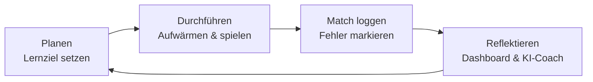

# Marvel Rivals Coach :material-controller:

Besser werden in einem Spiel funktioniert nach denselben Prinzipien wie jedes andere Lernen:
**Ziele setzen, gezielt üben, reflektieren.** Der *Rivals Coach* ist eine kleine Web-App, die dich
genau dabei unterstützt – und zeigt, wie KI-Tools als persönlicher Coach eingesetzt werden können.

[Rivals Coach öffnen :material-open-in-new:](app/){ .md-button .md-button--primary target="_blank" }

## Was die App kann

| Bereich | Wofür |
|---|---|
| **Dashboard** | Winrate, KDA, Verlauf, Statistik pro Held und Rolle sowie automatische Coach-Hinweise |
| **Match loggen** | Ergebnis, K/D/A, Schaden/Heilung, Fehler und Stärken pro Match festhalten |
| **Helden-Guide** | Grundregeln für Vanguard, Duelist und Strategist, Tipps zu jedem Helden und eigene Notizen |
| **Team-Check** | Rollenverteilung deines Teams prüfen (z.B. 2-2-2) und Hinweise zu Dive- oder Poke-Kompositionen |
| **Training** | Tägliche Routine mit Serien-Zähler, Übungen passend zu deinen häufigsten Fehlern, Aufwärm-Timer |
| **Lernziele** | SMARTe Ziele nach dem 3-Phasen-Modell: Planen, Durchführen, Reflektieren |
| **KI-Coach** | Erstellt aus deinen Daten einen fertigen Prompt für einen KI-Chatbot |
| **Daten** | Export/Import als JSON, Export der Matches als CSV |

!!! info "Datenschutz"
    Alle Eingaben werden ausschliesslich lokal in deinem Browser gespeichert (`localStorage`).
    Es werden keine Daten an einen Server übertragen. Mit dem Export kannst du ein Backup erstellen.

## So lernst du mit der App

1. **Planen:** Lege im Tab *Lernziele* ein kleines, messbares Ziel fest – z.B. „Diese Woche als Strategist im Schnitt höchstens 5 Tode“.
2. **Durchführen:** Wärme dich mit dem Timer auf und spiele mit einem kleinen Hero-Pool (2–3 Helden pro Rolle).
3. **Loggen:** Trage jedes Match direkt danach ein. Ehrlich markierte Fehler sind der wertvollste Teil.
4. **Reflektieren:** Schau dir nach jeder Session das Dashboard an. Der Coach erkennt Muster wie
   „In Niederlagen stirbst du deutlich öfter“ und schlägt passende Übungen vor.

## KI als Coach nutzen

Im Tab *KI-Coach* fasst die App deine Statistik, Fehler, Notizen und Ziele zu einem Prompt zusammen.
Diesen kannst du in einen KI-Chatbot wie [ChatGPT](../tools/chatgpt.md) kopieren und dir Feedback
oder einen Trainingsplan geben lassen. Tipps zum Formulieren guter Prompts findest du im
[Prompt-Engineering-Guide](../guides/prompt-engineering.md).

!!! warning "Kritisch bleiben"
    KI-Chatbots kennen oft nicht den aktuellen Patch-Stand und können sich bei Helden-Fähigkeiten irren.
    Nutze die Antworten als Denkanstoss und überprüfe sie im Spiel – genau wie bei jeder anderen KI-Anwendung.
